# Modèle de données

Source de vérité : `prisma/schema.prisma` et `prisma/migrations/`. Ce document en donne la
lecture métier. PostgreSQL standard (15 et 16), accès uniquement par Prisma 7 et l'adaptateur
`pg`, via la couche `src/server/`.

## Diagramme

```mermaid
erDiagram
  User ||--o{ UserProfile : "a les profils"
  User ||--o{ Account : "identité Google"
  User ||--o{ Session : "sessions en base"
  User ||--o{ Candidacy : "suit (owner)"
  User ||--o{ CandidacyEvent : "auteur"
  User ||--o{ FollowUp : "mène"
  User ||--o{ Document : "dépose"
  User ||--o{ DossierLink : "crée"
  User ||--o{ Notification : "reçoit"

  Person ||--o| PersonSensitive : "données sensibles"
  Person ||--o{ EmergencyContact : "personnes à prévenir"
  Person ||--o{ PersonSkill : ""
  Person ||--o{ PersonLanguage : ""
  Person ||--o{ PersonLicense : ""
  Person ||--o{ PersonDeclaredDiploma : ""
  Person ||--o{ PersonWishedActivity : ""
  Person ||--o{ PersonAnnex : ""
  Person ||--o{ TrainingRecord : "a suivi"
  Person ||--o{ TrainingWish : "souhaite"
  Person ||--o{ Appointment : "est nommé"
  Person ||--o{ Candidacy : "candidate"
  Person ||--o{ Mentorship : "filleul"
  Person ||--o{ Mentorship : "parrain"
  Person ||--o{ FollowUp : "points de suivi"
  Person ||--o{ DossierLink : "liens de dossier"
  Person ||--o{ DossierSubmission : "dossiers"
  Person ||--o{ Document : "documents"
  Person ||--o{ Notification : "concerne"

  ReferenceItem ||--o{ ReferenceItemPrerequisite : "exige"
  ReferenceItem ||--o{ ReferenceItemPrerequisite : "prérequis de"
  ReferenceItem ||--o{ TrainingSession : "sessions"
  ReferenceItem ||--o{ TrainingRecord : ""
  ReferenceItem ||--o{ TrainingWish : ""
  ReferenceItem ||--o{ Appointment : "fonction"
  TrainingSession |o--o{ TrainingRecord : ""
  TrainingSession |o--o{ TrainingWish : "session prévue"

  Candidacy ||--o{ CandidacyEvent : "historique"
  DossierLink |o--o{ DossierSubmission : ""
  DossierSubmission ||--o{ OtpChallenge : "codes"
  DossierSubmission ||--o{ Signature : "signatures"
  DossierSubmission ||--o{ DossierAttachment : "pièces jointes"
  DossierAttachment |o--o| Document : "devient"
  OtpChallenge |o--o| Signature : "valide"

  ReminderRule |o--o{ Notification : "produit"

  User ||--o{ Todo : "crée"
  User ||--o{ TodoAssignee : "a dans sa liste"
  TodoProject ||--o{ TodoProjectMember : "membres"
  TodoProject |o--o{ Todo : "range"
  Todo ||--o{ TodoAssignee : "assignés"
  Todo ||--o{ TodoComment : "fil"
  Person |o--o{ Todo : "concerne"

  Person {
    text id PK
    text ref UK "P-00001"
    text nivol UK "11 chiffres + 1 lettre"
    enum status
    bool legacy_import
    timestamptz archived_at
    date purge_eligible_at
  }
  TrainingRecord {
    text ref UK "S-00001"
    enum result
    date date
    date expires_at "calculé par l'application"
    timestamptz cancelled_at
  }
  Appointment {
    text ref UK "F-00001"
    date start_date
    date end_date
    timestamptz cancelled_at
  }
  ReferenceItem {
    text code UK
    enum category
    enum kind
    int validity_months
    bool expires_end_of_year
    enum_array perimeters
  }
  AuditLog {
    timestamptz at
    text actor_id
    enum action
    text entity
    text field
    jsonb old_value
    jsonb new_value
  }
  AccessLog {
    timestamptz at
    text user_id
    text person_id
    enum scope
  }
  Setting {
    text key UK
    jsonb value
  }
```

`AuditLog`, `AccessLog` et `Setting` n'ont aucune relation : les journaux doivent survivre aux
entités qu'ils décrivent (voir plus bas).

## Règles transverses

- **Identifiants** : `id` en texte, cuid2 généré par Prisma. Les entités métier ont en plus un
  numéro lisible tiré d'une séquence Postgres par la fonction `binivol_next_ref()`, valeur par
  défaut de la colonne : `P-00001` (personne), `S-00001` (formation suivie), `F-00001`
  (nomination). Le numéro passe à 6 chiffres après 99 999 au lieu de se tronquer.
- **Dates** : `timestamptz` pour les instants, `date` pour les dates sans heure (naissance,
  obtention, échéance). Les `date` arrivent en JavaScript à 00:00 UTC ; `toParisDay()`
  (`src/lib/dates.ts`) donne « aujourd'hui à Paris » dans la même forme.
- **Pas de suppression physique** des données métier. On archive (`archivedAt`) ou on annule
  avec trace (`cancelledAt`, `cancelledById`, `cancelReason`). Seule la purge RGPD de l'étape 14
  supprimera, à partir de `Person.purgeEligibleAt`. Les tables filles d'une personne sont en
  `ON DELETE CASCADE` pour que cette purge soit une seule opération.
- **Colonnes d'acteur** : `createdAt`, `updatedAt`, `createdById`, `updatedById` sur toute table
  métier. Les deux derniers sont nullables (import, système) et **sans clé étrangère** : ils
  restent valides même pour un acteur technique, et le journal d'audit fait foi.
- **Journaux en ajout seul** : `audit_logs` et `access_logs` refusent `UPDATE`, `DELETE` et
  `TRUNCATE` (déclencheur au niveau instruction, donc même quand aucune ligne n'est visée), sauf
  dans une transaction qui exécute `SET LOCAL binivol.allow_purge = 'on'`. Seule la purge RGPD
  (et la remise à zéro des tests) utilisera ce contournement.
- **Jetons et codes hachés** : `DossierLink.tokenHash` et `OtpChallenge.codeHash` ne
  contiennent que l'empreinte SHA-256 ; `Signature.ipHash` remplace l'adresse IP. Le jeton en
  clair n'existe que dans le lien envoyé.
- **Audit** : `withAudit()` (`src/server/audit.ts`) écrit le différentiel champ par champ dans la
  même transaction que la modification et remplace les valeurs sensibles par `"[sensible]"`.
- **Recherche** : `binivol_normalize()` (SQL pur, `IMMUTABLE`, sans extension `unaccent`) rend
  la recherche insensible aux accents et à la casse ; utilisable dans un index d'expression.
- **Libellés** : chaque valeur d'énumération a son libellé français dans `src/lib/labels.ts`
  (vérifié par un test).
- **Téléphones** : chiffres seuls (`0612345678`), normalisés à la saisie et à l'import, affichés
  par paires (`src/lib/phone.ts`). Un numéro étranger saisi avec `+` est gardé tel quel.
- **Visibilité en SQL** (étape 5) : les listes appliquent `visibleSql()`
  (`src/server/policy/visibility.ts`), miroir de `can()` testé contre lui, avant de compter et de
  paginer (ADR-025).
- **Documents** : la ligne `documents` est créée **après** l'écriture du fichier par
  `StorageService` (clé aléatoire, type vérifié par signature, SHA-256) ; jamais d'URL publique
  (`docs/storage.md`, ADR-026 et ADR-027). Un document archivé n'est visible que par TOPAZE.

## Contraintes posées en SQL

Prisma ne sait pas les exprimer ; elles sont dans
`prisma/migrations/20261104090200_constraints_and_triggers` (et, pour `managed_by`,
`20261104102527_auth_sessions_and_legacy_fields`). Les index partiels, eux, sont
déclarés dans le schéma (fonctionnalité `partialIndexes` de Prisma 7), donc préservés par les
migrations futures.

| Nom                                                                  | Table                        | Règle                                                                   |
| -------------------------------------------------------------------- | ---------------------------- | ----------------------------------------------------------------------- |
| `persons_nivol_format`                                               | persons                      | NIVOL nul ou `^[0-9]{11}[A-Z]$`                                         |
| `persons_nivol_required`                                             | persons                      | NIVOL obligatoire sauf CANDIDATE, LEFT, INACTIVE ou `legacy_import`     |
| `persons_left_requires_date`                                         | persons                      | `left_at` obligatoire si LEFT                                           |
| `persons_nivol_key` (unique)                                         | persons                      | un NIVOL par personne                                                   |
| `candidacies_one_open` (index partiel)                               | candidacies                  | une seule candidature avec `closed_at` nul par personne                 |
| `candidacies_closed_matches_stage`                                   | candidacies                  | close si et seulement si DONE ou ABANDONED                              |
| `training_wishes_one_open` (partiel)                                 | training_wishes              | un seul souhait OPEN, WAITLISTED ou SCHEDULED par personne et référence |
| `mentorships_not_self`                                               | mentorships                  | pas de parrainage de soi-même                                           |
| `mentorships_dates`, `appointments_dates`, `training_sessions_dates` | —                            | fin ≥ début                                                             |
| `appointments_reference_is_function`                                 | appointments (déclencheur)   | une nomination porte sur une référence de type FUNCTION                 |
| `reference_items_validity_positive`                                  | reference_items              | validité > 0 mois                                                       |
| `reference_item_prerequisites_not_self`                              | reference_item_prerequisites | une référence n'est pas son propre prérequis                            |
| `training_sessions_capacity_positive`                                | training_sessions            | capacité > 0                                                            |
| `documents_size_positive`, `documents_sha256_format`                 | documents                    | taille ≥ 0, SHA-256 en hexadécimal minuscule                            |
| `otp_challenges_attempts_positive`                                   | otp_challenges               | tentatives ≥ 0                                                          |
| `users_email_lowercase`                                              | users                        | e-mail stocké en minuscules                                             |
| `reference_items_managed_by_functions_only`                          | reference_items              | `managed_by` vide pour une formation (étape 3)                          |
| `audit_logs_append_only`, `access_logs_append_only`                  | journaux (déclencheurs)      | ajout seul                                                              |
| `todo_projects_name_length`, `todos_title_length`                    | todo_projects, todos         | nom 1 à 80, titre 1 à 200 caractères, non vides après `btrim`           |
| `todo_projects_description_length`, `todos_note_length`              | todo_projects, todos         | description ≤ 1 000, note ≤ 2 000                                       |
| `todo_comments_body_length`                                          | todo_comments                | commentaire 1 à 1 000 caractères, non vide après `btrim`                |
| `todos_completed_by`                                                 | todos                        | `completed_at` et `completed_by_id` nuls ou remplis ensemble            |
| `todo_assignees_one_active`, `todo_project_members_one_active`       | (index partiels)             | une seule assignation / adhésion active (`removed_at` nul) par couple   |

Les violations connues sont traduites en `DomainError` avec un message français par
`translateDbError()` (`src/server/errors.ts`).

**Attention pour les migrations futures** : le texte d'un index partiel doit être écrit comme
PostgreSQL le restitue (`status = ANY (ARRAY[...])` plutôt que `status IN (...)`), sinon Prisma
le recrée à chaque migration. Toujours relire le SQL produit par `pnpm db:migrate --create-only`.

## Tables

Sensibilité : **N** normale, **S** sensible (accès filtré à l'étape 3, journalisé dans
`access_logs`, valeurs masquées dans l'audit).

### Comptes

| Table           | Rôle                                             | Champs clés                                                      | Sens. |
| --------------- | ------------------------------------------------ | ---------------------------------------------------------------- | ----- |
| `users`         | Responsable qui se connecte                      | `email` unique en minuscules, `active`, `last_login_at`          | N     |
| `user_profiles` | Profils cumulables d'un responsable              | `(user_id, profile)` unique                                      | N     |
| `accounts`      | Identité Google liée à un compte (Auth.js)       | `(provider, provider_account_id)` unique ; **aucun jeton OAuth** | N     |
| `sessions`      | Sessions en base (Auth.js, stratégie `database`) | `session_token` unique (cookie HttpOnly), `expires`              | N     |

Les bénévoles n'ont pas de compte. `accounts` et `sessions` sont des données techniques :
une session est supprimée à la déconnexion et à la désactivation du compte. Un compte n'est
jamais supprimé, seulement désactivé.

### Personnes

| Table                      | Rôle                                                                                                                                                                                | Champs clés                                                                                                         | Sens. |
| -------------------------- | ----------------------------------------------------------------------------------------------------------------------------------------------------------------------------------- | ------------------------------------------------------------------------------------------------------------------- | ----- |
| `persons`                  | Candidat **et** bénévole (un seul modèle) ; `is_trainer` (colonne « Formateur », nul = inconnu, vrai → périmètre FORMAT_GP) et `legacy_drive_folder_id` (colonne « Dossier Drive ») | `ref`, `nivol`, identité, contacts, `status`, départ, aptitude, `legacy_import`, `archived_at`, `purge_eligible_at` | N     |
| `person_sensitive`         | Naissance, adresse, B3, autorisation parentale (1–1)                                                                                                                                | `person_id` unique                                                                                                  | S     |
| `emergency_contacts`       | Personnes à prévenir, ordonnées (`position`)                                                                                                                                        | civilité, nom, lien, adresse, 2 téléphones, e-mail                                                                  | S     |
| `person_skills`            | Compétences et niveau ; archivage `archived_at` (étape 5)                                                                                                                           | `label`, `level`                                                                                                    | N     |
| `person_languages`         | Langues et niveau ; archivage `archived_at` (étape 5)                                                                                                                               | `label`, `level`                                                                                                    | N     |
| `person_licenses`          | Permis de conduire ; archivage `archived_at` (étape 5), une ligne par catégorie                                                                                                     | `(person_id, category)` unique                                                                                      | N     |
| `person_declared_diplomas` | Diplômes déclarés dans le dossier (texte libre)                                                                                                                                     | `label`                                                                                                             | N     |
| `person_wished_activities` | Activités souhaitées (texte libre)                                                                                                                                                  | `label`                                                                                                             | N     |
| `person_annexes`           | Compétences annexes (conducteur VPSP…) ; archivage `archived_at` (étape 5)                                                                                                          | `code`, `valid_until`                                                                                               | N     |

### Référentiel, formations, nominations

| Table                          | Rôle                                                      | Champs clés                                                                                                                             | Sens. |
| ------------------------------ | --------------------------------------------------------- | --------------------------------------------------------------------------------------------------------------------------------------- | ----- |
| `reference_items`              | Formations et fonctions (21 codes du classeur + 3 ajouts) | `code` unique, `category`, `kind`, `validity_months`, `expires_end_of_year`, `forbidden_for_minors`, **`perimeters`**, **`managed_by`** | N     |
| `reference_item_prerequisites` | Prérequis (n–n réflexive)                                 | `(item_id, prerequisite_id)`                                                                                                            | N     |
| `training_sessions`            | Session organisée                                         | dates, lieu, `pegass_url`, capacité, annulation                                                                                         | N     |
| `training_records`             | Formation suivie (feuille « Sessions »)                   | `ref` S-, `result`, `date` (souvent inconnue), `expires_at` calculé, annulation                                                         | N     |
| `training_wishes`              | Souhait de formation                                      | `status`, `priority`, session prévue                                                                                                    | N     |
| `appointments`                 | Nomination à une fonction (feuille « Fonctions »)         | `ref` F-, dates, `authorized_by`, `decision_ref`, annulation                                                                            | N     |

`expires_at` est calculé par `computeExpiresAt()` (`src/server/reference.ts`) et représente le
**dernier jour de validité** : validité en mois, ou 31/12 de l'année d'obtention, ou 31/12 de
l'année atteinte après N mois si les deux sont posés ; `null` si la date d'obtention est inconnue
ou si la référence n'expire pas.

`perimetersOf()` (`src/server/perimeter.ts`) déduit les périmètres ACTION, LASER et FORMAT_GP
d'une personne de ses formations **validées et non expirées** et de ses nominations actives,
d'après `reference_items.perimeters`.

### Candidatures, intégration, suivi

| Table              | Rôle                                                                                                                   | Champs clés                                                                                                                                                                                                 | Sens. |
| ------------------ | ---------------------------------------------------------------------------------------------------------------------- | ----------------------------------------------------------------------------------------------------------------------------------------------------------------------------------------------------------- | ----- |
| `candidacies`      | Candidature (une seule ouverte) ; passages par la machine de `src/server/candidacy/machine.ts` (`docs/integration.md`) | `stage`, `source`, `owner_id`, `follow_up_at`, `meeting_at`, `notes`, `abandon_reason` (enum, obligatoire si abandon, CHECK `candidacies_abandon_reason`), `abandoned_reason` (note d'abandon), `closed_at` | N     |
| `candidacy_events` | Historique des étapes, un par passage, dans la transaction du passage                                                  | `from_stage`, `to_stage`, `at`, `author_id`, `note`                                                                                                                                                         | N     |
| `mentorships`      | Parrainage                                                                                                             | `mentee_id`, `mentor_id`, dates                                                                                                                                                                             | N     |
| `follow_ups`       | Points de suivi (3 mois, annuel)                                                                                       | `kind`, `scheduled_at`, `done_at`, `conducted_by_id`, `next_date`                                                                                                                                           | N     |

### Dossier, documents, signature

| Table                 | Rôle                                                                                                                         | Champs clés                                                                                                                                                                                               | Sens.    |
| --------------------- | ---------------------------------------------------------------------------------------------------------------------------- | --------------------------------------------------------------------------------------------------------------------------------------------------------------------------------------------------------- | -------- |
| `dossier_links`       | Lien sécurisé envoyé au candidat (`REMOTE`) ou mode sur place (`ON_SITE`) ; réutilisable jusqu'à l'envoi (`docs/dossier.md`) | `token_hash` unique (SHA-256, le jeton n'est jamais stocké), `mode`, `expires_at`, `used_at`, `revoked_at`                                                                                                | S (hash) |
| `dossier_submissions` | Contenu du dossier en ligne : `DRAFT` → `SUBMITTED` (à signer) → `SIGNED` (à contresigner) → `COMPLETE`                      | `status`, `data` JSONB (`dossierDraftSchema`), `schema_version` (2), `link_id`, `submitted_at`, `signed_at`, `countersign_started_at` (réserve), `completed_at`, `final_mail_sent_at`, `final_mail_error` | S        |
| `dossier_attachments` | Pièce jointe d'un dossier avant l'envoi ; à l'envoi, elle devient un `Document`                                              | `kind` (`DIPLOMA_COPY`, `PARENTAL_AUTH`, `ADHESION`), `storage_key` unique, `sha256`, `document_id`, `archived_at`                                                                                        | S        |
| `outbound_mails`      | E-mails du pilote `log` (`docs/mail.md`), lus dans `/admin/courriels`                                                        | `to`, `subject`, `payload` (chiffré AES-256-GCM), `created_by_id`                                                                                                                                         | S        |
| `otp_challenges`      | Code de signature (`docs/signature.md`) : 6 chiffres, 10 min, 5 essais                                                       | `code_hash` (HMAC salé), `email`, `signer_role`, `attempts`, `verified_at`                                                                                                                                | S        |
| `signatures`          | Preuve d'une signature, une par rôle et par dossier                                                                          | `signer_role`, `method` (`OTP_EMAIL`, `IN_PERSON`, `SESSION`), `verified_email`, `verified_by_id`, `image_key` ou `typed_name` (CHECK), `ip_hash`, `user_agent`, `document_hashes`                        | S        |
| `documents`           | Fichier stocké derrière `StorageService` ; les PDF signés y sont la copie UL                                                 | `kind`, `copy`, `storage_key` unique, `sha256`, `file_missing`, `version`, `submission_id`                                                                                                                | S        |

### Rappels, notifications, paramètres

| Table            | Rôle                                   | Champs clés                                                                | Sens. |
| ---------------- | -------------------------------------- | -------------------------------------------------------------------------- | ----- |
| `reminder_rules` | Règles du moteur de rappels (étape 12) | `key` unique, `trigger`, `offset_days`, `recipients`, `channels`, `params` | N     |
| `notifications`  | Notification d'un responsable          | `(user_id, dedupe_key)` unique, `read_at`                                  | N     |
| `settings`       | Paramètres de l'outil                  | `key` unique, `value` JSONB                                                | N     |

### À faire (étape 16, `/a-faire`)

Listes de travail des responsables : tâches personnelles, confiées ou partagées, et projets
communs. La visibilité est **relationnelle** (`src/server/policy/todos.ts`) : on voit une tâche
si on en est l'auteur (`owner_id`), un assigné actif, ou un membre actif de son projet. TOPAZE
n'a pas de passe-droit. Rien n'est supprimé : `archived_at` (tâche, projet, commentaire) et
`removed_at` (assignation, adhésion), en ajout seul.

| Table                  | Rôle                                                                                             | Champs clés                                                                                                                                                         | Sens.                                  |
| ---------------------- | ------------------------------------------------------------------------------------------------ | ------------------------------------------------------------------------------------------------------------------------------------------------------------------- | -------------------------------------- |
| `todo_projects`        | Projet commun (« Forum des associations »)                                                       | `name` (1–80), `description` (≤ 1 000), `color` (jeton : `INK`, `ACCENT`, `OK`, `WARN`, `DANGER`, `MUTED`), `owner_id`, `archived_at`                               | N                                      |
| `todo_project_members` | Adhésion à un projet, rôle `OWNER` ou `MEMBER` ; retirer remplit `removed_at`                    | `(project_id, user_id)` unique tant que `removed_at` est nul, `added_by_id`, index `(user_id, removed_at)`                                                          | N                                      |
| `todos`                | Tâche ; faite quand un assigné la coche                                                          | `owner_id`, `project_id`, `title` (1–200), `note` (≤ 2 000), `due_date` (jour, Europe/Paris), `person_id` (mis à nul à la purge), `completed_at`, `completed_by_id` | N (titre et note masqués dans l'audit) |
| `todo_assignees`       | Qui a la tâche dans sa liste ; sans assignation explicite, l'auteur ; plusieurs = tâche partagée | `(todo_id, user_id)` unique tant que `removed_at` est nul, `assigned_by_id`, `position` (ordre propre à chaque liste), index `(user_id, removed_at)`                | N                                      |
| `todo_comments`        | Fil court d'une tâche partagée ou de projet, ajout seul                                          | `author_id`, `body` (≤ 1 000), `archived_at`                                                                                                                        | N (texte masqué dans l'audit)          |

Index : `(project_id, completed_at, due_date)` sur `todos`, et index partiels
`todos_owner_active`, `todos_person_active` (`archived_at IS NULL`).

### Import

| Table         | Rôle                                              | Champs clés                                                                                      | Sens.                         |
| ------------- | ------------------------------------------------- | ------------------------------------------------------------------------------------------------ | ----------------------------- |
| `import_runs` | Historique des simulations et imports du classeur | auteur, `dry_run`, `status`, `file_name`, `file_size`, `file_sha256`, `counts`, `report` (JSONB) | N (le rapport cite des NIVOL) |

Les ID de l'ancien classeur sont gardés dans `legacy_ref` (`candidacies`, `training_records`,
`appointments`) et l'empreinte des lignes du Journal dans `audit_logs.legacy_hash` ; ils ne sont
jamais réutilisés comme `ref`.

### Journaux

| Table         | Rôle                                                                                                                                                                                                        | Champs clés                                                                   | Sens.                |
| ------------- | ----------------------------------------------------------------------------------------------------------------------------------------------------------------------------------------------------------- | ----------------------------------------------------------------------------- | -------------------- |
| `audit_logs`  | Toute écriture, champ par champ, connexions (LOGIN, LOGIN_DENIED, LOGOUT) ; `legacy_action` garde le libellé du Journal importé ; `entity` nul seulement pour une action système importée (« Sauvegarde »…) | `actor_id`/`actor_label`, `action`, `entity`, `field`, valeurs JSONB masquées | N (valeurs masquées) |
| `access_logs` | Consultations de données sensibles                                                                                                                                                                          | `user_id`, `person_id`, `scope`, `context`                                    | N                    |

## Référentiel du seed

Les 21 premiers codes reprennent **exactement** l'onglet « Referentiel » de l'ancien classeur
(pas de donnée personnelle) : libellés, catégories, type, interdiction aux mineurs et échéance au
31/12. Aucun code n'a de validité en mois (`validity_months` nul partout) ni de prérequis dans le
classeur. PSC, FPSC et ASSIST_FORM sont des ajouts de Binivol, absents du classeur, à confirmer.
Source : `prisma/seed/referenceData.ts`.

| Ordre | Code        | Libellé                                           | Catégorie    | Type     | Interdite aux mineurs | Échéance 31/12 | Périmètres    | `managed_by`  | Note                                   |
| ----- | ----------- | ------------------------------------------------- | ------------ | -------- | --------------------- | -------------- | ------------- | ------------- | -------------------------------------- |
| 1     | PSE         | Premiers secours en équipe                        | FORMATION_IS | TRAINING | non                   | non            | ACTION, LASER | —             | —                                      |
| 2     | FCPSE       | Formation continue PSE                            | FORMATION_IS | TRAINING | non                   | **oui**        | —             | —             | Validité à renseigner                  |
| 3     | F_CI        | Formation chef d'intervention                     | FORMATION_IS | TRAINING | non                   | non            | —             | —             | —                                      |
| 4     | F_CH        | Formation chauffeur                               | FORMATION_IS | TRAINING | non                   | non            | —             | —             | —                                      |
| 5     | OPR         | Opérateur radio                                   | FORMATION_IS | TRAINING | non                   | non            | —             | —             | —                                      |
| 6     | ECG         | Formation ECG (réseau de secours)                 | FORMATION_IS | TRAINING | non                   | non            | —             | —             | —                                      |
| 7     | GQS         | Gestes qui sauvent                                | TRONC_COMMUN | TRAINING | non                   | non            | —             | —             | —                                      |
| 8     | CRB         | Croix-Rouge Bienvenue (eCRB)                      | TRONC_COMMUN | TRAINING | non                   | non            | —             | —             | —                                      |
| 9     | TCAU        | Tronc commun des acteurs de l'urgence (eTCAU)     | TRONC_COMMUN | TRAINING | non                   | non            | LASER         | —             | —                                      |
| 10    | TCAS        | Tronc commun des acteurs de la solidarité (eTCAS) | TRONC_COMMUN | TRAINING | non                   | non            | —             | —             | —                                      |
| 11    | CHEF_PAPS   | Chef de PAPS                                      | SECOURS      | FUNCTION | **oui**               | non            | —             | ACTION        | —                                      |
| 12    | CI          | Chef d'intervention (fonction)                    | SECOURS      | FUNCTION | **oui**               | non            | —             | LASER         | —                                      |
| 13    | CDPE        | Chef de dispositif de petite envergure            | SECOURS      | FUNCTION | **oui**               | non            | —             | ACTION        | —                                      |
| 14    | CI_SDIS     | CI réseau de secours SDIS                         | SECOURS      | FUNCTION | **oui**               | non            | —             | LASER         | —                                      |
| 15    | CH_TECH     | Chauffeur technique                               | SECOURS      | FUNCTION | **oui**               | non            | —             | ACTION, LASER | Interprétation à valider               |
| 16    | CH_FIXE     | Chauffeur fixe                                    | SECOURS      | FUNCTION | **oui**               | non            | —             | ACTION, LASER | Interprétation à valider               |
| 17    | CH_MOBILE   | Chauffeur mobile                                  | SECOURS      | FUNCTION | **oui**               | non            | —             | ACTION, LASER | Interprétation à valider               |
| 18    | CH_RESEAUX  | Chauffeur réseaux                                 | SECOURS      | FUNCTION | **oui**               | non            | —             | ACTION, LASER | Interprétation à valider               |
| 19    | FPSE        | Formateur PSE                                     | FORMATION_IS | TRAINING | non                   | non            | FORMAT_GP     | —             | Validité à renseigner                  |
| 20    | FCCI        | Formation continue chef d'intervention            | FORMATION_IS | TRAINING | non                   | **oui**        | —             | —             | Libellé à confirmer                    |
| 21    | TCEO        | Tronc commun des encadrants opérationnels         | FORMATION_IS | TRAINING | non                   | non            | —             | —             | —                                      |
| 22    | PSC         | Prévention et secours civiques de niveau 1        | TRONC_COMMUN | TRAINING | non                   | non            | ACTION        | —             | Hypothèse, absent de l'ancien classeur |
| 23    | FPSC        | Formateur PSC                                     | FORMATION_GP | TRAINING | non                   | non            | FORMAT_GP     | —             | Hypothèse, absent de l'ancien classeur |
| 24    | ASSIST_FORM | Assistant de formation                            | FORMATION_GP | FUNCTION | non                   | non            | FORMAT_GP     | FORMAT_GP     | Hypothèse, absent de l'ancien classeur |

Les notes « Interprétation à valider » portent le texte complet « Interprétation à valider
(équipage d'évacuation interdit aux mineurs, permis requis) ».

- **Périmètres** (`perimeters`, visibilité des profils) : ajout de Binivol, inchangé depuis
  l'étape 2. La case « Formateur » d'une personne (`is_trainer`) ajoute aussi FORMAT_GP.
- **Qui nomme à quelle fonction** (`managed_by`) : **répartition par défaut, à confirmer**.
  CHEF_PAPS et CDPE par ACTION ; CI et CI_SDIS par LASER ; les quatre CH_* par ACTION et LASER ;
  ASSIST_FORM par FORMAT GP. TOPAZE peut nommer à toutes les fonctions. Vide pour les
  formations (contrainte `reference_items_managed_by_functions_only`).
- **Échéance au 31/12** : le 31 décembre de l'année d'obtention, même pour une obtention en
  décembre (confirmé par la note de FCCI : « à refaire tous les ans, échéance au 31/12 »).

## Correspondance avec l'ancien classeur (import, étape 4)

Intitulés exacts de la ligne 1 de chaque onglet du classeur v03 ; seule la structure est
décrite ici, jamais les données. L'import (`src/server/import/`, guide `docs/import.md`) compare
les intitulés après suppression des espaces en trop : une colonne attendue absente est une
erreur bloquante, une colonne inconnue un avertissement. Ordre : Referentiel, Parametres,
Benevoles, Prospects, Sessions, Fonctions, Journal. Le 8e onglet du vrai classeur, « Listes »
(Statut bénévole, Aptitude, Résultat session, Catégorie, Type, Oui/Non : les listes déroulantes),
n'est pas repris : Binivol a ses propres listes. Tout autre onglet est signalé « non repris ».

**Sort d'une colonne** : _importée_ (vers le champ indiqué), _audit_ (gardée dans l'entrée
`IMPORT` du journal d'audit, pas dans un champ), _non reprise_ (avec la raison).

### Valeurs communes

| Valeur       | Règle                                                                                                                                                                                                                                                                           |
| ------------ | ------------------------------------------------------------------------------------------------------------------------------------------------------------------------------------------------------------------------------------------------------------------------------- |
| Oui/Non      | « OUI » → vrai, « NON » → faux, **vide → `null`** (inconnu) ; autre texte → `null` + avertissement                                                                                                                                                                              |
| Dates        | date Excel (cas du vrai classeur), nombre de série Excel ou texte `JJ/MM/AAAA` → jour calendaire ; illisible → `null` + avertissement, jamais un rejet de la ligne                                                                                                              |
| Horodatages  | date-heure Excel, série avec fraction ou `JJ/MM/AAAA HH:MM` → instant, heure de Paris                                                                                                                                                                                           |
| NIVOL        | `normalizeNivol()` (espaces retirés, majuscules) ; invalide → **ligne rejetée**                                                                                                                                                                                                 |
| E-mails      | en minuscules                                                                                                                                                                                                                                                                   |
| Téléphones   | stockés en **nombres à 9 chiffres** dans le classeur (0 de tête perdu) : `612345678` → `0612345678` ; texte avec espaces, points ou `+33` → 10 chiffres ; autre valeur gardée telle quelle + avertissement. Stockés en chiffres seuls, affichés par paires (`src/lib/phone.ts`) |
| Lignes vides | ignorées sans bruit                                                                                                                                                                                                                                                             |

Listes : Statut (Candidat → CANDIDATE, Actif → ACTIVE, Suspendu → SUSPENDED, Inactif → INACTIVE,
Parti(e) → LEFT ; autre → rejet). Aptitude (Apte → FIT, Non apte → UNFIT, Retiré(e) → WITHDRAWN,
À vérifier → TO_CHECK ; autre → `null` + avertissement). Résultat (Validé → PASSED, Inscrit(e) →
REGISTERED, À confirmer → TO_CONFIRM, Non validé → FAILED, Absent → ABSENT ; vide ou autre →
TO_CONFIRM, avec avertissement si autre). Étape (Premier contact → FIRST_CONTACT, Dossier en cours
→ FILE ; autre → FIRST_CONTACT + avertissement). Comparaisons sans accents ni casse.

### Onglet « Benevoles » → `persons` + `person_sensitive` (clé : NIVOL)

| Colonne                    | Sort                                                      | Remarque                                                                                                |
| -------------------------- | --------------------------------------------------------- | ------------------------------------------------------------------------------------------------------- |
| NIVOL                      | importée → `persons.nivol`                                | clé ; invalide ou en double dans l'onglet → ligne rejetée                                               |
| Prénom, Nom                | importées → `first_name`, `last_name`                     | manquants → ligne rejetée                                                                               |
| E-mail, Téléphone          | importées → `email`, `phone`                              |                                                                                                         |
| Date de naissance          | importée → `person_sensitive.birth_date`                  | sensible, masquée dans l'audit                                                                          |
| Statut                     | importée → `status`                                       | inconnu → ligne rejetée                                                                                 |
| Date d'entrée              | importée → `entry_date`                                   |                                                                                                         |
| Date de départ             | importée → `left_at`                                      | Parti(e) sans date → « Modifié le », sinon jour de l'import, + avertissement ; `left_reason` reste vide |
| Adhérent                   | importée → `is_member`                                    | Oui/Non, vide = inconnu                                                                                 |
| Aptitude (Pegass)          | importée → `aptitude`                                     |                                                                                                         |
| Date aptitude              | importée → `aptitude_date`                                |                                                                                                         |
| Autre AASC                 | importée → `other_aasc`                                   | Oui/Non, vide = inconnu                                                                                 |
| Formateur                  | importée → `is_trainer`                                   | vrai → périmètre FORMAT_GP                                                                              |
| Encadrant régulier mineurs | importée → `regular_minor_supervisor`                     | Oui/Non, vide = inconnu                                                                                 |
| Date vérif. B3             | importée → `person_sensitive.b3_checked_at`               | sensible ; `b3_status` reste vide (le résultat n'est pas dans le classeur)                              |
| Autorisation parentale     | importée → `person_sensitive.parental_authorization`      | sensible, vide = inconnu                                                                                |
| Date autorisation          | importée → `person_sensitive.parental_authorization_date` | sensible                                                                                                |
| Notes                      | importée → `notes`                                        |                                                                                                         |
| Modifié le, Modifié par    | audit                                                     | dans l'entrée `IMPORT` (`legacy`), pas dans `updated_at`                                                |
| Dossier Drive              | importée → `legacy_drive_folder_id`                       | pour la reprise des fichiers                                                                            |

Toute personne importée porte `legacy_import = true`.

### Onglet « Prospects » → `persons` (CANDIDATE) + `candidacies` (clé : ID → `candidacies.legacy_ref`)

| Colonne                            | Sort                                         | Remarque                                                                                                       |
| ---------------------------------- | -------------------------------------------- | -------------------------------------------------------------------------------------------------------------- |
| ID                                 | importée → `candidacies.legacy_ref`          | jamais réutilisé comme `ref` ; en double → ligne rejetée                                                       |
| Prénom, Nom, E-mail, Téléphone     | importées → `persons.*`                      | personne créée en CANDIDATE, sauf prospect rattaché                                                            |
| Date de naissance                  | importée → `person_sensitive.birth_date`     | sensible                                                                                                       |
| Source, Intérêt                    | importées → `candidacies.source`, `interest` | texte gardé tel quel                                                                                           |
| Date de premier contact            | importée → `candidacies.first_contact_at`    | minuit à Paris                                                                                                 |
| Étape                              | importée → `candidacies.stage`               | rattaché → DONE et close                                                                                       |
| Prochaine action, Date de relance  | importées → `next_action`, `follow_up_at`    |                                                                                                                |
| Notes                              | importée → `persons.notes`                   |                                                                                                                |
| NIVOL attribué                     | importée (rattachement)                      | si le NIVOL est dans Benevoles : candidature rattachée à ce bénévole, close en DONE, aucune personne en double |
| Saisi le                           | importée → `candidacies.created_at`          |                                                                                                                |
| Saisi par, Modifié le, Modifié par | audit                                        |                                                                                                                |

### Onglet « Sessions » → `training_records` (clé : ID → `legacy_ref`)

| Colonne          | Sort                      | Remarque                                            |
| ---------------- | ------------------------- | --------------------------------------------------- |
| ID               | importée → `legacy_ref`   | `ref` S- attribué par Binivol                       |
| NIVOL            | importée → `person_id`    | inconnu ou invalide → ligne rejetée                 |
| Code             | importée → `reference_id` | inconnu, ou de type FUNCTION → ligne rejetée        |
| Date             | importée → `date`         | vide sur la grande majorité des lignes              |
| Résultat         | importée → `result`       | `expires_at` calculé (`computeExpiresAt`) si Validé |
| Organisme / lieu | importée → `place`        |                                                     |
| Lien Pegass      | importée → `pegass_url`   |                                                     |
| Commentaire      | importée → `comment`      |                                                     |
| Saisi le         | importée → `created_at`   |                                                     |
| Saisi par        | audit                     |                                                     |

### Onglet « Fonctions » → `appointments` (clé : ID → `legacy_ref`)

| Colonne                    | Sort                                                          | Remarque                                                                                                                                                                    |
| -------------------------- | ------------------------------------------------------------- | --------------------------------------------------------------------------------------------------------------------------------------------------------------------------- |
| ID                         | importée → `legacy_ref`                                       | `ref` F- attribué par Binivol                                                                                                                                               |
| NIVOL                      | importée → `person_id`                                        | inconnu ou invalide → ligne rejetée                                                                                                                                         |
| Fonction                   | importée → `reference_id`                                     | doit être de type FUNCTION, sinon rejet                                                                                                                                     |
| Date de début, Date de fin | importées → `start_date`, `end_date`                          | début vide sur plus de 90 % des lignes : sans début, non annulée et sans fin, la nomination est **active** (et compte dans `perimetersOf`)                                  |
| Autorisée par              | importée → `authorized_by`                                    |                                                                                                                                                                             |
| Référence décision         | importée → `decision_ref`                                     |                                                                                                                                                                             |
| Commentaire                | importée → `comment`                                          |                                                                                                                                                                             |
| Saisi le                   | importée → `created_at`                                       |                                                                                                                                                                             |
| Saisi par                  | audit                                                         |                                                                                                                                                                             |
| Annulée                    | importée → `cancelled_at`, `cancelled_by_id`, `cancel_reason` | `JJ/MM/AAAA par <email> : <motif>` ; e-mail sans compte → `cancelled_by_id` vide et e-mail en tête du motif ; format libre → jour de l'import, texte complet, avertissement |

Pas de contrôle « interdite aux mineurs » : c'est l'historique. Un mineur nommé à une fonction
interdite donne seulement un avertissement.

### Onglet « Referentiel » → `reference_items` (clé : Code)

Comparé, **jamais écrasé** : une différence de libellé, de catégorie, de type, d'échéance au 31/12
ou d'interdiction aux mineurs est un avertissement. Un code absent de Binivol est créé **inactif**,
avec un avertissement.

| Colonne                                                                  | Sort                                                                                                                                                                                                        |
| ------------------------------------------------------------------------ | ----------------------------------------------------------------------------------------------------------------------------------------------------------------------------------------------------------- |
| Code, Libellé, Catégorie, Type, Interdite aux mineurs, Échéance au 31/12 | comparées (créées pour un code nouveau) ; Catégorie « Formation IS », « Tronc commun », « Secours » → `FORMATION_IS`, `TRONC_COMMUN`, `SECOURS` ; Type « Formation », « Fonction » → `TRAINING`, `FUNCTION` |
| Ordre, Source / commentaire                                              | utilisées pour un code nouveau (`sort_order`, `note`)                                                                                                                                                       |
| Validité (mois), Prérequis                                               | non reprises : vides pour tous les codes du classeur                                                                                                                                                        |
| Actif                                                                    | non reprise : l'activité se gère dans Binivol                                                                                                                                                               |

### Onglet « Parametres » (Clé, Valeur, Description) → `settings`

| Clé                   | Sort                                     | Raison                                                                  |
| --------------------- | ---------------------------------------- | ----------------------------------------------------------------------- |
| DELAI_ALERTE_JOURS    | importée → `ALERT_DAYS_BEFORE_EXPIRY`    |                                                                         |
| CONSERVATION_ANS      | importée → `RETENTION_YEARS_AFTER_LEAVE` |                                                                         |
| SAUVEGARDES_A_GARDER  | importée → `BACKUPS_TO_KEEP`             |                                                                         |
| CLASSIFICATION        | importée → `DATA_CLASSIFICATION`         |                                                                         |
| MAILS_VOEUX_ACTIFS    | importée → `GREETING_EMAILS_ENABLED`     |                                                                         |
| EMAILS_ALERTES        | non reprise                              | destinataires définis par profil (`reminder_rules`)                     |
| EDITEURS              | non reprise                              | « comptes à créer depuis l'administration » ; adresses jamais recopiées |
| DOSSIER_SAUVEGARDE_ID | non reprise                              | dossier Google Drive, remplacé par `StorageService`                     |
| DOSSIER_BENEVOLES_ID  | non reprise (présente deux fois)         | dossier Google Drive, remplacé par `StorageService`                     |
| VERSION               | non reprise                              | version de l'ancien outil                                               |

La colonne Description sert de description à un paramètre créé.

### Onglet « Journal » → `audit_logs` (clé : SHA-256 de la ligne → `legacy_hash`)

| Colonne                          | Sort                                       | Remarque                                                                                                                                                                                                                                                                       |
| -------------------------------- | ------------------------------------------ | ------------------------------------------------------------------------------------------------------------------------------------------------------------------------------------------------------------------------------------------------------------------------------ |
| Horodatage                       | importée → `at`                            | illisible → jour de l'import + avertissement                                                                                                                                                                                                                                   |
| Utilisateur                      | importée → `actor_label`                   |                                                                                                                                                                                                                                                                                |
| Action                           | importée → `legacy_action`                 | `action = IMPORT`                                                                                                                                                                                                                                                              |
| Table, Clé, Champ                | importées → `entity`, `entity_id`, `field` | Clé : NIVOL, `S-…`, `F-…`, `P-…`, code ou clé de paramètre ; Table et Clé vides (actions système : « Sauvegarde »…) → `entity` et `entity_id` à `null` ; Champ peut être une plage (`H29:J29`)                                                                                 |
| Ancienne valeur, Nouvelle valeur | importées → `old_value`, `new_value`       | converties en texte lisible **avant** masquage et empreinte : date Excel → `JJ/MM/AAAA`, nombre de 5 chiffres dans une colonne de date → `JJ/MM/AAAA`, nombre de 9 chiffres → téléphone `0…` ; **masquées** `"[sensible]"` pour naissance, B3, autorisation parentale, adresse |

`legacy_hash` est l'empreinte de la ligne normalisée **masquée** : une ligne n'est jamais importée
deux fois, et l'empreinte ne permet pas de retrouver une valeur sensible.

### Règles de l'import

- **Rejouable et idempotent** : même fichier → tout « inchangé », aucune écriture métier ; fichier
  modifié → seules les lignes changées sont mises à jour ; rien n'est jamais supprimé.
- **Conflit** : une ligne dont l'entité a une entrée d'audit autre que `IMPORT` depuis son dernier
  import (modifiée dans Binivol) n'est pas écrasée : « ignorée pour conflit », avec les champs.
- **Audit** : chaque création ou modification écrit une entrée `IMPORT` (`actor_label`
  « Import »), valeurs sensibles masquées ; une entrée `ImportRun` résume chaque import réel.
- **Une transaction** sous verrou consultatif : tout ou rien ; un second import simultané est
  refusé. Le fichier n'est jamais stocké : `import_runs` garde le nom, la taille, l'empreinte
  SHA-256, les compteurs et le rapport.
