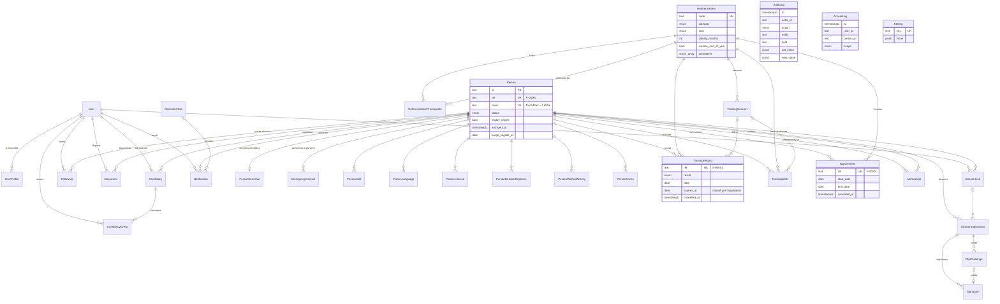

# Modèle de données

Source de vérité : `prisma/schema.prisma` et `prisma/migrations/`. Ce document en donne la
lecture métier. PostgreSQL standard (15 et 16), accès uniquement par Prisma 7 et l'adaptateur
`pg`, via la couche `src/server/`.

## Diagramme

`AuditLog`, `AccessLog` et `Setting` n'ont aucune relation : les journaux doivent survivre aux
entités qu'ils décrivent (voir plus bas).

## Règles transverses

- **Identifiants** : `id` en texte, cuid2 généré par Prisma. Les entités métier ont en plus un
  numéro lisible tiré d'une séquence Postgres par la fonction `binivol_next_ref()`, valeur par
  défaut de la colonne : `P-00001` (personne), `S-00001` (formation suivie), `F-00001`
  (nomination). Le numéro passe à 6 chiffres après 99 999 au lieu de se tronquer.
- **Dates** : `timestamptz` pour les instants, `date` pour les dates sans heure (naissance,
  obtention, échéance). Les `date` arrivent en JavaScript à 00:00 UTC ; `toParisDay()`
  (`src/lib/dates.ts`) donne « aujourd'hui à Paris » dans la même forme.
- **Pas de suppression physique** des données métier. On archive (`archivedAt`) ou on annule
  avec trace (`cancelledAt`, `cancelledById`, `cancelReason`). Seule la purge RGPD de l'étape 14
  supprimera, à partir de `Person.purgeEligibleAt`. Les tables filles d'une personne sont en
  `ON DELETE CASCADE` pour que cette purge soit une seule opération.
- **Colonnes d'acteur** : `createdAt`, `updatedAt`, `createdById`, `updatedById` sur toute table
  métier. Les deux derniers sont nullables (import, système) et **sans clé étrangère** : ils
  restent valides même pour un acteur technique, et le journal d'audit fait foi.
- **Journaux en ajout seul** : `audit_logs` et `access_logs` refusent `UPDATE`, `DELETE` et
  `TRUNCATE` (déclencheur au niveau instruction, donc même quand aucune ligne n'est visée), sauf
  dans une transaction qui exécute `SET LOCAL binivol.allow_purge = 'on'`. Seule la purge RGPD
  (et la remise à zéro des tests) utilisera ce contournement.
- **Jetons et codes hachés** : `DossierLink.tokenHash` et `OtpChallenge.codeHash` ne
  contiennent que l'empreinte SHA-256 ; `Signature.ipHash` remplace l'adresse IP. Le jeton en
  clair n'existe que dans le lien envoyé.
- **Audit** : `withAudit()` (`src/server/audit.ts`) écrit le différentiel champ par champ dans la
  même transaction que la modification et remplace les valeurs sensibles par `"[sensible]"`.
- **Recherche** : `binivol_normalize()` (SQL pur, `IMMUTABLE`, sans extension `unaccent`) rend
  la recherche insensible aux accents et à la casse ; utilisable dans un index d'expression.
- **Libellés** : chaque valeur d'énumération a son libellé français dans `src/lib/labels.ts`
  (vérifié par un test).

## Contraintes posées en SQL

Prisma ne sait pas les exprimer ; elles sont dans
`prisma/migrations/20261104090200_constraints_and_triggers`. Les index partiels, eux, sont
déclarés dans le schéma (fonctionnalité `partialIndexes` de Prisma 7), donc préservés par les
migrations futures.

| Nom                                                                  | Table                        | Règle                                                                   |
| -------------------------------------------------------------------- | ---------------------------- | ----------------------------------------------------------------------- |
| `persons_nivol_format`                                               | persons                      | NIVOL nul ou `^[0-9]{11}[A-Z]$`                                         |
| `persons_nivol_required`                                             | persons                      | NIVOL obligatoire sauf CANDIDATE, LEFT, INACTIVE ou `legacy_import`     |
| `persons_left_requires_date`                                         | persons                      | `left_at` obligatoire si LEFT                                           |
| `persons_nivol_key` (unique)                                         | persons                      | un NIVOL par personne                                                   |
| `candidacies_one_open` (index partiel)                               | candidacies                  | une seule candidature avec `closed_at` nul par personne                 |
| `candidacies_closed_matches_stage`                                   | candidacies                  | close si et seulement si DONE ou ABANDONED                              |
| `training_wishes_one_open` (partiel)                                 | training_wishes              | un seul souhait OPEN, WAITLISTED ou SCHEDULED par personne et référence |
| `mentorships_not_self`                                               | mentorships                  | pas de parrainage de soi-même                                           |
| `mentorships_dates`, `appointments_dates`, `training_sessions_dates` | —                            | fin ≥ début                                                             |
| `appointments_reference_is_function`                                 | appointments (déclencheur)   | une nomination porte sur une référence de type FUNCTION                 |
| `reference_items_validity_positive`                                  | reference_items              | validité > 0 mois                                                       |
| `reference_item_prerequisites_not_self`                              | reference_item_prerequisites | une référence n'est pas son propre prérequis                            |
| `training_sessions_capacity_positive`                                | training_sessions            | capacité > 0                                                            |
| `documents_size_positive`, `documents_sha256_format`                 | documents                    | taille ≥ 0, SHA-256 en hexadécimal minuscule                            |
| `otp_challenges_attempts_positive`                                   | otp_challenges               | tentatives ≥ 0                                                          |
| `users_email_lowercase`                                              | users                        | e-mail stocké en minuscules                                             |
| `audit_logs_append_only`, `access_logs_append_only`                  | journaux (déclencheurs)      | ajout seul                                                              |

Les violations connues sont traduites en `DomainError` avec un message français par
`translateDbError()` (`src/server/errors.ts`).

**Attention pour les migrations futures** : le texte d'un index partiel doit être écrit comme
PostgreSQL le restitue (`status = ANY (ARRAY[...])` plutôt que `status IN (...)`), sinon Prisma
le recrée à chaque migration. Toujours relire le SQL produit par `pnpm db:migrate --create-only`.

## Tables

Sensibilité : **N** normale, **S** sensible (accès filtré à l'étape 3, journalisé dans
`access_logs`, valeurs masquées dans l'audit).

### Comptes

| Table           | Rôle                                  | Champs clés                            | Sens. |
| --------------- | ------------------------------------- | -------------------------------------- | ----- |
| `users`         | Responsable qui se connecte (étape 3) | `email` unique en minuscules, `active` | N     |
| `user_profiles` | Profils cumulables d'un responsable   | `(user_id, profile)` unique            | N     |

Les bénévoles n'ont pas de compte. Les tables d'Auth.js viendront à l'étape 3.

### Personnes

| Table                      | Rôle                                                 | Champs clés                                                                                                         | Sens. |
| -------------------------- | ---------------------------------------------------- | ------------------------------------------------------------------------------------------------------------------- | ----- |
| `persons`                  | Candidat **et** bénévole (un seul modèle)            | `ref`, `nivol`, identité, contacts, `status`, départ, aptitude, `legacy_import`, `archived_at`, `purge_eligible_at` | N     |
| `person_sensitive`         | Naissance, adresse, B3, autorisation parentale (1–1) | `person_id` unique                                                                                                  | S     |
| `emergency_contacts`       | Personnes à prévenir, ordonnées (`position`)         | civilité, nom, lien, adresse, 2 téléphones, e-mail                                                                  | S     |
| `person_skills`            | Compétences et niveau                                | `label`, `level`                                                                                                    | N     |
| `person_languages`         | Langues et niveau                                    | `label`, `level`                                                                                                    | N     |
| `person_licenses`          | Permis de conduire                                   | `(person_id, category)` unique                                                                                      | N     |
| `person_declared_diplomas` | Diplômes déclarés dans le dossier (texte libre)      | `label`                                                                                                             | N     |
| `person_wished_activities` | Activités souhaitées (texte libre)                   | `label`                                                                                                             | N     |
| `person_annexes`           | Compétences annexes (conducteur VPSP…)               | `code`, `valid_until`                                                                                               | N     |

### Référentiel, formations, nominations

| Table                          | Rôle                                                      | Champs clés                                                                                                           | Sens. |
| ------------------------------ | --------------------------------------------------------- | --------------------------------------------------------------------------------------------------------------------- | ----- |
| `reference_items`              | Formations et fonctions (21 codes du classeur + 3 ajouts) | `code` unique, `category`, `kind`, `validity_months`, `expires_end_of_year`, `forbidden_for_minors`, **`perimeters`** | N     |
| `reference_item_prerequisites` | Prérequis (n–n réflexive)                                 | `(item_id, prerequisite_id)`                                                                                          | N     |
| `training_sessions`            | Session organisée                                         | dates, lieu, `pegass_url`, capacité, annulation                                                                       | N     |
| `training_records`             | Formation suivie (feuille « Sessions »)                   | `ref` S-, `result`, `date` (souvent inconnue), `expires_at` calculé, annulation                                       | N     |
| `training_wishes`              | Souhait de formation                                      | `status`, `priority`, session prévue                                                                                  | N     |
| `appointments`                 | Nomination à une fonction (feuille « Fonctions »)         | `ref` F-, dates, `authorized_by`, `decision_ref`, annulation                                                          | N     |

`expires_at` est calculé par `computeExpiresAt()` (`src/server/reference.ts`) et représente le
**dernier jour de validité** : validité en mois, ou 31/12 de l'année d'obtention, ou 31/12 de
l'année atteinte après N mois si les deux sont posés ; `null` si la date d'obtention est inconnue
ou si la référence n'expire pas.

`perimetersOf()` (`src/server/perimeter.ts`) déduit les périmètres ACTION, LASER et FORMAT_GP
d'une personne de ses formations **validées et non expirées** et de ses nominations actives,
d'après `reference_items.perimeters`.

### Candidatures, intégration, suivi

| Table              | Rôle                             | Champs clés                                                       | Sens. |
| ------------------ | -------------------------------- | ----------------------------------------------------------------- | ----- |
| `candidacies`      | Candidature (une seule ouverte)  | `stage`, `source`, `owner_id`, `follow_up_at`, `closed_at`        | N     |
| `candidacy_events` | Historique des étapes            | `from_stage`, `to_stage`, `at`, `author_id`                       | N     |
| `mentorships`      | Parrainage                       | `mentee_id`, `mentor_id`, dates                                   | N     |
| `follow_ups`       | Points de suivi (3 mois, annuel) | `kind`, `scheduled_at`, `done_at`, `conducted_by_id`, `next_date` | N     |

### Dossier, documents, signature

| Table                 | Rôle                                     | Champs clés                                                                  | Sens.    |
| --------------------- | ---------------------------------------- | ---------------------------------------------------------------------------- | -------- |
| `dossier_links`       | Lien sécurisé envoyé au candidat         | `token_hash` unique, `mode`, `expires_at`, `used_at`, `revoked_at`           | S (hash) |
| `dossier_submissions` | Contenu du dossier en ligne              | `status`, `data` JSONB (validé par Zod à l'étape 7), `schema_version`        | S        |
| `otp_challenges`      | Code à usage unique avant signature      | `code_hash`, `email`, `attempts`, `verified_at`                              | S        |
| `signatures`          | Signature d'un document                  | `signer_role`, `image_key`, `otp_challenge_id`, `ip_hash`, `document_hashes` | S        |
| `documents`           | Fichier stocké derrière `StorageService` | `kind`, `copy`, `storage_key` unique, `sha256`, `file_missing`               | S        |

### Rappels, notifications, paramètres

| Table            | Rôle                                   | Champs clés                                                                | Sens. |
| ---------------- | -------------------------------------- | -------------------------------------------------------------------------- | ----- |
| `reminder_rules` | Règles du moteur de rappels (étape 12) | `key` unique, `trigger`, `offset_days`, `recipients`, `channels`, `params` | N     |
| `notifications`  | Notification d'un responsable          | `(user_id, dedupe_key)` unique, `read_at`                                  | N     |
| `settings`       | Paramètres de l'outil                  | `key` unique, `value` JSONB                                                | N     |

### Journaux

| Table         | Rôle                               | Champs clés                                                                   | Sens.                |
| ------------- | ---------------------------------- | ----------------------------------------------------------------------------- | -------------------- |
| `audit_logs`  | Toute écriture, champ par champ    | `actor_id`/`actor_label`, `action`, `entity`, `field`, valeurs JSONB masquées | N (valeurs masquées) |
| `access_logs` | Consultations de données sensibles | `user_id`, `person_id`, `scope`, `context`                                    | N                    |

## Référentiel du seed

L'ancien classeur n'est pas dans le dépôt : les 21 codes viennent de la spécification, leurs
libellés, catégories, validités et prérequis sont **reconstitués** (`prisma/seed/referenceData.ts`)
et doivent être vérifiés. PSC, FPSC et ASSIST_FORM sont des ajouts marqués « Hypothèse à
confirmer » dans `note`.

| Code        | Libellé (à vérifier)                          | Catégorie    | Type     | Validité | Périmètres    |
| ----------- | --------------------------------------------- | ------------ | -------- | -------- | ------------- |
| PSC         | Prévention et secours civiques de niveau 1    | TRONC_COMMUN | TRAINING | —        | ACTION        |
| TCAU        | Tronc commun acteur de l'urgence              | TRONC_COMMUN | TRAINING | —        | LASER         |
| TCAS        | Tronc commun action sociale                   | TRONC_COMMUN | TRAINING | —        |               |
| TCEO        | Tronc commun encadrement opérationnel         | TRONC_COMMUN | TRAINING | —        |               |
| PSE         | Premiers secours en équipe                    | SECOURS      | TRAINING | —        | ACTION, LASER |
| FCPSE       | Formation continue PSE                        | SECOURS      | TRAINING | 31/12    |               |
| OPR         | Opérateur radio                               | SECOURS      | TRAINING | 36 mois  |               |
| ECG         | Réalisation d'électrocardiogramme             | SECOURS      | TRAINING | —        |               |
| CHEF_PAPS   | Chef de point d'alerte et de premiers secours | SECOURS      | FUNCTION | —        |               |
| CI          | Chef d'intervention                           | SECOURS      | FUNCTION | —        |               |
| CDPE        | Chef de dispositif                            | SECOURS      | FUNCTION | —        |               |
| CI_SDIS     | Chef d'intervention conventionné SDIS         | SECOURS      | FUNCTION | —        |               |
| CH_TECH     | Chargé technique                              | SECOURS      | FUNCTION | —        |               |
| CH_FIXE     | Chargé poste fixe                             | SECOURS      | FUNCTION | —        |               |
| CH_MOBILE   | Chargé poste mobile                           | SECOURS      | FUNCTION | —        |               |
| CH_RESEAUX  | Chargé réseaux                                | SECOURS      | FUNCTION | —        |               |
| F_CI        | Formation chef d'intervention                 | FORMATION_IS | TRAINING | —        |               |
| F_CH        | Formation chargé                              | FORMATION_IS | TRAINING | —        |               |
| FCCI        | Formation continue chef d'intervention        | FORMATION_IS | TRAINING | 31/12    |               |
| FPSE        | Formateur PSE                                 | FORMATION_IS | TRAINING | —        | FORMAT_GP     |
| FPSC        | Formateur PSC                                 | FORMATION_GP | TRAINING | —        | FORMAT_GP     |
| ASSIST_FORM | Assistant de formation                        | FORMATION_GP | FUNCTION | —        | FORMAT_GP     |
| GQS         | Gestes qui sauvent                            | AUTRE        | TRAINING | —        |               |
| CRB         | CRB (libellé à confirmer)                     | AUTRE        | TRAINING | —        |               |

Toutes les fonctions SECOURS ont `forbidden_for_minors = true`.

## Correspondance avec l'ancien classeur (pour l'étape 4)

Le classeur n'étant pas dans le dépôt, les intitulés de colonnes ci-dessous sont **présumés**
d'après la spécification ; ils seront confrontés au fichier réel au début de l'étape 4 et ce
tableau sera corrigé.

### Feuille des bénévoles → `persons` (+ tables liées)

| Colonne présumée                                     | Table.champ                                                                       | Remarque                                                          |
| ---------------------------------------------------- | --------------------------------------------------------------------------------- | ----------------------------------------------------------------- |
| N° (P-…)                                             | `persons.ref`                                                                     | conservé ; la séquence est recalée (`setval`) après import        |
| NIVOL                                                | `persons.nivol`                                                                   | `normalizeNivol()` ; 46/46 au format 11 chiffres + 1 lettre       |
| Civilité, Nom, Prénom, Nom de naissance, Nom d'usage | `persons.civility`, `last_name`, `first_name`, `birth_name`, `usage_name`         |                                                                   |
| Mail, Téléphone, Mail pro, Téléphone pro, Mail CRF   | `persons.email`, `phone`, `pro_email`, `pro_phone`, `crf_email`                   |                                                                   |
| Statut                                               | `persons.status`                                                                  | libellés → enum ; `legacy_import = true` sur toute ligne importée |
| Date d'entrée, Date de départ, Motif, Commentaire    | `persons.entry_date`, `left_at`, `left_reason`, `left_comment`                    | motif texte → enum, sinon OTHER + texte dans le commentaire       |
| Adhérent                                             | `persons.is_member`                                                               |                                                                   |
| Aptitude, Date d'aptitude                            | `persons.aptitude`, `aptitude_date`                                               |                                                                   |
| Autre AASC, Encadrant régulier de mineurs            | `persons.other_aasc`, `regular_minor_supervisor`                                  |                                                                   |
| Profession, Secteur, Employeur, Remarques            | `persons.profession`, `sector`, `company`, `notes`                                |                                                                   |
| Date, ville, département, pays de naissance          | `person_sensitive.birth_*`                                                        | sensible                                                          |
| Adresse, complément, CP, ville, pays                 | `person_sensitive.street`, `address_complement`, `postal_code`, `city`, `country` | sensible                                                          |
| Date et résultat du B3                               | `person_sensitive.b3_checked_at`, `b3_status`                                     | sensible                                                          |
| Autorisation parentale, date                         | `person_sensitive.parental_authorization`, `parental_authorization_date`          | sensible                                                          |
| Personne à prévenir (1 et 2)                         | `emergency_contacts` (`position` 0 et 1)                                          | sensible                                                          |
| Compétences, Langues, Permis                         | `person_skills`, `person_languages`, `person_licenses`                            | cellules multi-valeurs découpées                                  |
| Compétences annexes (conducteur VPSP…)               | `person_annexes`                                                                  |                                                                   |

### Feuille « Sessions » → `training_records`

| Colonne présumée               | Table.champ                      | Remarque                                 |
| ------------------------------ | -------------------------------- | ---------------------------------------- |
| N° (S-…)                       | `training_records.ref`           | conservé ; séquence recalée              |
| NIVOL ou N° de la personne     | `training_records.person_id`     | rapprochement par NIVOL, sinon par N° P- |
| Code formation                 | `training_records.reference_id`  | par `reference_items.code`               |
| Date                           | `training_records.date`          | vide accepté (fréquent)                  |
| Résultat                       | `training_records.result`        | vide → TO_CONFIRM                        |
| Lieu, Lien Pegass, Commentaire | `place`, `pegass_url`, `comment` |                                          |

### Feuille « Fonctions » → `appointments`

| Colonne présumée                                 | Table.champ                                | Remarque                    |
| ------------------------------------------------ | ------------------------------------------ | --------------------------- |
| N° (F-…)                                         | `appointments.ref`                         | conservé ; séquence recalée |
| NIVOL ou N° de la personne                       | `appointments.person_id`                   |                             |
| Code fonction                                    | `appointments.reference_id`                | doit être de type FUNCTION  |
| Date de début, Date de fin                       | `start_date`, `end_date`                   |                             |
| Autorisé par, Référence de décision, Commentaire | `authorized_by`, `decision_ref`, `comment` |                             |

### Référentiel et paramètres

| Feuille     | Table             | Remarque                                                                                                                       |
| ----------- | ----------------- | ------------------------------------------------------------------------------------------------------------------------------ |
| Référentiel | `reference_items` | code, libellé, catégorie, type, validité, option « échéance au 31/12 »                                                         |
| Paramètres  | `settings`        | `ALERT_DAYS_BEFORE_EXPIRY`, `RETENTION_YEARS_AFTER_LEAVE`, `BACKUPS_TO_KEEP`, `DATA_CLASSIFICATION`, `GREETING_EMAILS_ENABLED` |

### Colonnes non reprises (prévision)

| Colonne présumée                                           | Raison                                                                 |
| ---------------------------------------------------------- | ---------------------------------------------------------------------- |
| Colonnes calculées (âge, jours avant échéance, « à jour ») | recalculées à l'affichage ou stockées par l'application (`expires_at`) |
| Date d'échéance saisie à la main                           | remplacée par `computeExpiresAt()` ; un écart sera signalé à l'import  |
| Mises en forme, couleurs, filtres, onglets de synthèse     | pas des données                                                        |
| Mots de passe ou paramètres de macros éventuels            | sans objet, et jamais stockés                                          |
