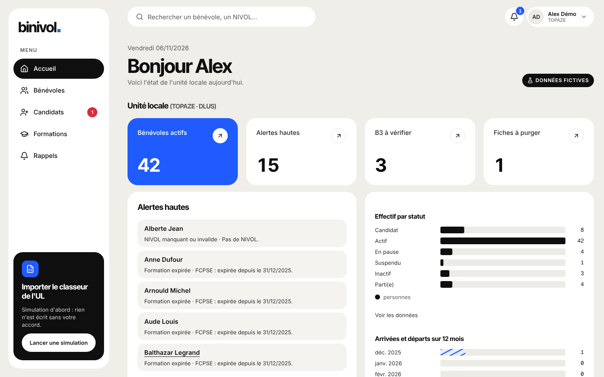

# Design system Binivol : direction « Suisse »

Direction validée le 06/11/2026 (ADR-064) : grille nette, noir et blanc, **un seul bleu pour
signaler**. Rigoureux et intemporel. Référence visuelle : le canevas
https://claude.ai/artifact/CrnbH9ZGwWK5RHrRUyMiKM (page Maquettes, ligne 01).

Tout le design system est visible sur la page `/design` (toujours en développement, en
production seulement avec `ENABLE_DESIGN_PAGE=true`). Les tokens vivent dans
`src/app/globals.css`, les composants dans `src/components/ui/`, la géométrie du logo dans
`src/components/brand/`.

## Principes

1. **Le noir agit, l'accent signale.** Les actions principales et l'élément actif sont en `ink`.
   Le bleu `accent` est l'unique accent : il met en avant, montre une progression, dessine le focus.
2. **Une seule `StatCard highlight` par écran.** Elle marque le chiffre qui compte.
3. **Un statut = une pastille et un libellé.** Jamais la couleur seule (`StatusDot`).
4. **Les motifs (hachures) sont réservés aux données** : barres, rails de progression, matrices.
5. **Pas d'ombre sur les cartes.** Elles se détachent par le contraste blanc sur gris. Seuls les
   menus flottants portent `shadow-pop`.
6. **Pas de pilule pour ce qui se clique** : boutons et navigation ont des angles nets (8 px,
   6 px pour les marques). Le rond est réservé aux avatars, aux pastilles de statut et aux
   compteurs.

## Tokens

Les valeurs brutes sont des variables sur `:root` (`--canvas`, `--ink`…) et le bloc
`@theme inline` les expose à Tailwind (`bg-canvas`, `text-ink`…). Un thème sombre pourra
redéfinir les variables sous `[data-theme="dark"]` sans toucher aux composants.

### Couleurs

| Token                                   | Valeur                            | Usage                                                |
| --------------------------------------- | --------------------------------- | ---------------------------------------------------- |
| `canvas`                                | `#F4F4F2`                         | Fond de l'application                                |
| `surface`                               | `#FFFFFF`                         | Cartes, menus, navigation latérale                   |
| `veil`                                  | `#F4F4F2`                         | Survols, sous-blocs **dans** une carte blanche       |
| `ink`                                   | `#0F0F0F`                         | Texte, actions principales, élément actif            |
| `ink-2`                                 | `#2B2B2B`                         | Texte secondaire fort, survol de `ink`               |
| `muted`                                 | `#5A5A57`                         | Texte secondaire, surtitres                          |
| `line`                                  | `#E3E3DF`                         | Filets, séparation des lignes de tableau             |
| `accent`                                | `#1F5BFF`                         | Accent unique                                        |
| `accent-2`                              | `#A9C1FF`                         | Hachures des données **seulement** (jamais de texte) |
| `accent-soft`                           | `#E6EDFF`                         | Fond doux d'accent                                   |
| `accent-ink`                            | `#1A45C4`                         | Texte accent sur fond doux ou sur blanc              |
| `ok` / `ok-soft` / `ok-ink`             | `#22A06B` / `#DFF5EA` / `#176B48` | inchangés                                            |
| `warn` / `warn-soft` / `warn-ink`       | `#E5A100` / `#FFF3D1` / `#8A6200` | inchangés                                            |
| `danger` / `danger-soft` / `danger-ink` | `#D92D3A` / `#FDE3E5` / `#A81E29` | inchangés                                            |

`veil` vaut désormais `canvas` : il ne sert plus à distinguer un bloc posé sur le fond (les
colonnes du tableau des candidats, les onglets, les sous-navigations ont reçu un filet `line`
ou un fond blanc).

### Contrastes mesurés (WCAG 2.1, test `src/lib/__tests__/contrast.test.ts`)

Le test lit les valeurs dans `globals.css` : il suit la palette réelle.

| Paire                                                   | Ratio                  | Verdict                                                |
| ------------------------------------------------------- | ---------------------- | ------------------------------------------------------ |
| `muted` sur `canvas`                                    | 6,28 : 1               | AA                                                     |
| `muted` sur `surface`                                   | 6,92 : 1               | AA                                                     |
| `accent` sur `surface`                                  | 5,25 : 1               | AA                                                     |
| `accent` sur `canvas`                                   | 4,77 : 1               | AA                                                     |
| blanc sur `accent`                                      | 5,25 : 1               | AA (StatCard highlight)                                |
| `accent-ink` sur `accent-soft`                          | 6,66 : 1               | AA                                                     |
| `accent` sur `accent-soft`                              | 4,48 : 1               | **échec** → le texte sur fond doux est en `accent-ink` |
| `accent-ink` sur blanc                                  | 7,80 : 1               | AA (badge de la StatCard highlight)                    |
| blanc sur `ink`, `ink` sur `canvas`                     | 19,17 / 17,41 : 1      | AAA                                                    |
| `warn-ink` / `ok-ink` / `danger-ink` sur leur fond doux | 4,96 / 5,69 / 6,00 : 1 | AA                                                     |

**Valeurs ajustées pour le contraste.**

- `accent-soft` `#E6EDFF` et `accent-ink` `#1A45C4` ont été recalculés dans la teinte de
  `#1F5BFF` : 6,66 : 1 entre eux.
- La StatCard `highlight` n'utilise plus de dégradé : avec le nouvel `accent-2` (très clair), le
  texte blanc tomberait à 1,79 : 1 en haut de la carte. Elle est en `accent` plein (5,25 : 1),
  et son badge de variation est blanc avec un texte `accent-ink` (7,80 : 1) au lieu d'un blanc
  translucide (échec relevé par axe).
- `muted` (`#5A5A57`) est conforme tel quel, sur `canvas` comme sur `surface`.

### Rayons

| Classe            | Valeur  | Usage                                                     |
| ----------------- | ------- | --------------------------------------------------------- |
| `rounded-card`    | 12 px   | Cartes, StatCard, dialogues                               |
| `rounded-inner`   | 8 px    | Sous-blocs, menus flottants                               |
| `rounded-field`   | 8 px    | Champs                                                    |
| `rounded-control` | 8 px    | Boutons, boutons-icônes, liens d'action                   |
| `rounded-mark`    | 6 px    | Chips, marques de code, éléments de navigation            |
| `rounded-bar`     | 3 px    | Barres de graphique (en haut seulement : `rounded-t-bar`) |
| `rounded-pill`    | 9999 px | Avatars, pastilles de statut, compteurs **seulement**     |

### Ombres, espacements

- `shadow-pop` : menus flottants et dialogues uniquement.
- Grille de 4 px (échelle Tailwind). Gouttière entre cartes `gap-4` (16 px). Padding des cartes
  `p-5` / `sm:p-6`. Gouttière de page `px-gutter` (16 px), conteneur `max-w-app` (1440 px).

### Motifs

- `bg-hatch-accent` : hachures 135°, bandes de 6 px, `accent` / `accent-2`.
- `bg-hatch-ink` : idem en `ink` / `#3A3A3A`.
- `bg-hatch-track` : rail de progression en `line` / `veil`.

### Typographie

Polices chargées par `next/font/google` : téléchargées au build et servies par l'application
(aucune requête vers Google à l'exécution, la CSP n'autorise que `font-src 'self'`).

- **Inter Tight 700** pour les titres (`h1`, `h2`, `h3` et `font-display`), interlettrage
  −0,035em ;
- **Inter** pour le texte courant ;
- **Geist Mono** pour les NIVOL, références et codes (ADR-064).

| Classe         | Taille / interligne | Poids | Interlettrage            | Police                                       |
| -------------- | ------------------- | ----- | ------------------------ | -------------------------------------------- |
| `text-display` | 46 / 50             | 700   | −0,035em                 | Inter Tight                                  |
| `text-title`   | 26 / 32             | 700   | −0,035em                 | Inter Tight                                  |
| `text-figure`  | 34 / 38             | 700   | −0,035em, `tabular-nums` | Inter Tight (`font-display`)                 |
| `text-section` | 19 / 26             | 700   | −0,02em                  | Inter Tight                                  |
| `text-body`    | 15 / 22             | 400   |                          | Inter                                        |
| `text-small`   | 13 / 18             |       |                          | Inter                                        |
| `text-mono`    | 12,5 / 18           |       | avec `font-mono`         | Geist Mono                                   |
| `eyebrow`      | 12 / 16, capitales  | 600   | 0,1em                    | Inter, couleur à part (`eyebrow text-muted`) |

### Mouvement

Tout est neutralisé sous `prefers-reduced-motion` (durées ramenées à 0, aucun déplacement).

| Utilitaire       | Effet                                                                                         |
| ---------------- | --------------------------------------------------------------------------------------------- |
| `animate-rise`   | apparition des cartes : `translateY(14px)` → 0, opacité, 0,6 s, `cubic-bezier(0.2,0.8,0.2,1)` |
| `animate-grow`   | barres qui montent (`scaleY`, 1,1 s), `origin-bottom`                                         |
| `animate-grow-x` | barres horizontales (`scaleX`, 1,1 s), `origin-left`                                          |
| `hover-lift`     | carte cliquable : −3 px au survol (souris seulement)                                          |
| `press`          | bouton pressé : `scale(0.97)`                                                                 |

## Logo (piste A « Point », ADR-065)

- **Logotype** : « binivol » en minuscules, Inter Tight 700, interlettrage −0,05em, encre
  `#0F0F0F`, suivi d'un carré plein bleu `#1F5BFF` (côté 0,22 × la taille du texte, posé sur la
  ligne de base, espacé de 0,07em). Version blanche sur fond encre (`tone="white"`). Jamais de
  croix rouge.
- **Icône** : carré encre de rayon 8 (sur 48), « b » blanc Inter Tight 700 et petit carré bleu en
  bas à droite du b.
- **Composant** : `src/components/ui/Logo.tsx`, SVG en ligne, variantes `full` et `mark`,
  `aria-label="Binivol"` (ou `decorative` dans un lien déjà nommé).
- **Tracés** : les glyphes sont convertis une fois en chemins SVG
  (`src/components/brand/logoPaths.ts`, `pnpm logo:paths <InterTight-Bold.ttf>`) : le logo ne
  dépend jamais d'une police chargée.
- **Fichiers** (`pnpm icons`) : `src/app/icon.svg`, `src/app/apple-icon.png` (180),
  `public/icons/icon-192.png` et `icon-512.png` (manifeste `src/app/manifest.ts`),
  `public/brand/binivol-email.png` (mot, 320 px, pour les e-mails HTML).

## Composants

| Composant                                        | Notes                                                                                                                                                          |
| ------------------------------------------------ | -------------------------------------------------------------------------------------------------------------------------------------------------------------- |
| `Button`                                         | `primary` (fond ink, texte blanc), `outline` = secondaire (blanc, filet 1 px ink), `accent`, `soft`, `ghost` ; rayon 8 ; `sm`/`md`/`lg` ; pressé `scale(0.97)` |
| `IconButton`                                     | 44 px, rayon 8 ; `outline`, `ink`, `accent` ; `aria-label` obligatoire (typé)                                                                                  |
| `SectionTabs` (ex-`NavPills`)                    | sous-navigation d'une section, bande blanche filetée, actif en `ink` rayon 6, `aria-current="page"`                                                            |
| `SideNav` (`components/layout`)                  | navigation principale : barre latérale blanche dès 1024 px, rail compact dès 640 px                                                                            |
| `BottomNav` (`components/layout`)                | navigation principale sous 640 px                                                                                                                              |
| `Card`, `CardHeader`, `CardTitle`, `CardContent` | surface blanche, rayon 12, sans ombre, apparition `animate-rise`                                                                                               |
| `StatCard`                                       | `default` (blanc), `highlight` (accent plein, une par écran), `dark` ; surtitre `eyebrow`, chiffre Inter Tight                                                 |
| `Chip`                                           | rayon 6 ; tons `neutral`, `accent`, `ok`, `warn`, `danger`, `ink`                                                                                              |
| `StatusDot`                                      | point rond **et** libellé ; statuts dans `src/lib/status.ts`                                                                                                   |
| `Field`, `Input`, `Textarea`, `Select`           | rayon 8, 44 px ; label obligatoire, aide et erreur reliées par `aria-describedby`                                                                              |
| `SearchInput`                                    | rayon 8, loupe, `aria-label` obligatoire                                                                                                                       |
| `DataTable`                                      | en-tête blanc, lignes séparées par `line`, survol très léger (`veil/60`), cartes sous 640 px                                                                   |
| `Avatar`                                         | initiales dans un rond (seul usage du rond avec les pastilles)                                                                                                 |
| `BarChart`                                       | barres horizontales SVG, hachures pour la série secondaire, tableau des données dépliable                                                                      |
| `HatchedBarChart`                                | barres verticales, haut arrondi 3 px, montée `animate-grow`                                                                                                    |
| `ProgressBar`                                    | rail hachuré, rayon 3, remplissage accent, `role="progressbar"`                                                                                                |
| `Dialog`, `DropdownMenu`                         | rayon 12 / 8, `shadow-pop`                                                                                                                                     |
| `Logo`                                           | voir plus haut                                                                                                                                                 |

Règles d'usage :

- la taille `sm` des boutons (36 px) est réservée aux tableaux denses sur ordinateur, jamais
  sur un écran mobile ni dans le parcours candidat : ailleurs, tout ce qui se clique mesure au
  moins 44 × 44 px ;
- les champs ont une police de 16 px sous 640 px (pas de zoom iOS) ;
- `focus-ring` est l'unique style de focus (anneau `accent`, décalé sur `canvas`), visible sur
  les fonds blanc, gris et encre ;
- un NIVOL s'affiche avec `formatNivol()` dans une cellule mono (exemple fictif :
  `00012345678A`).

## Coquille

- **Ordinateur (≥ 1024 px)** : barre latérale blanche de 240 px (logo, navigation avec libellés,
  actif en `ink`), barre supérieure collante (recherche, notifications, menu du compte).
- **Tablette (640 à 1023 px)** : rail compact de 80 px (icône du logo, icônes et libellés courts).
- **Téléphone (< 640 px)** : logo dans la barre supérieure, `BottomNav` en bas (5 icônes et
  libellés).
- Route group `(public)` : logo centré, sans navigation, pour le parcours candidat.

## Captures

Régénérées par `pnpm captures` (`scripts/captures/captures.spec.ts`, seed fictif), chaque écran
en trois largeurs : `<écran>-1440.png`, `<écran>-834.png`, `<écran>-390.png` dans
`docs/captures/`. Exemples : `accueil-*`, `annuaire-*`, `fiche-*`, `candidats-*`, `matrice-*`,
`alertes-*`, `reglages-*`, `dossier-*` et `signature-*` (parcours candidat), `contresignature-*`.

Six captures gardent l'ancienne direction (écrans non rejoués par le script) :
`dossier-sur-place-390`, `finalisation-1440`, `gaia-nivol-1440`, `import-simulation-1440`,
`signature-parent-390`, `signature-bloc-parent-1440`.

