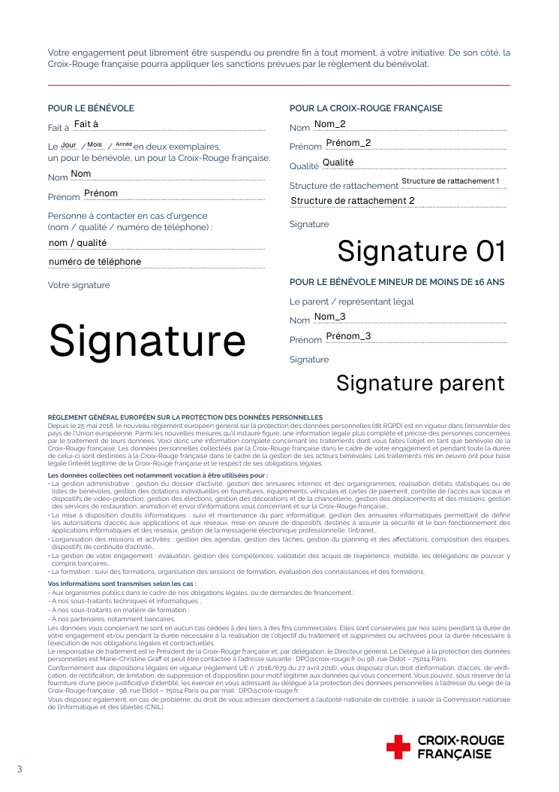
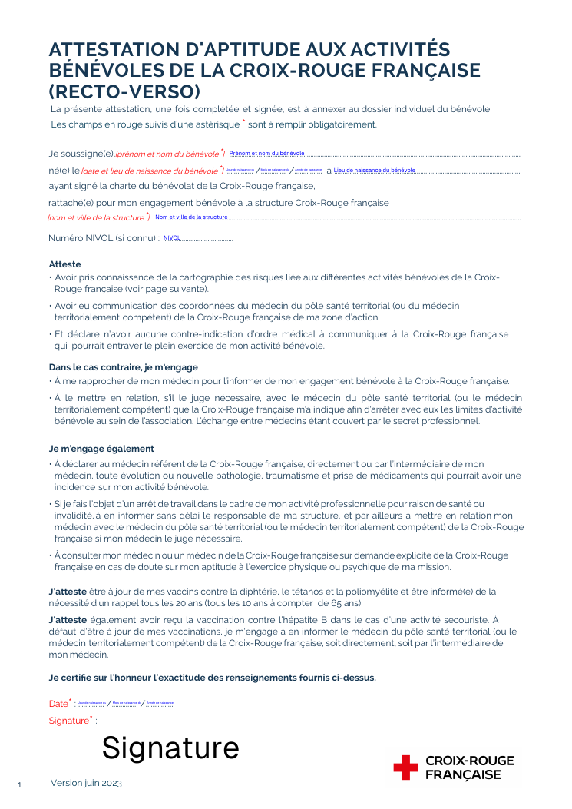

# Dossier bénévole en ligne (étapes 7 et 8)

Le candidat remplit son dossier sur son téléphone, sans compte, depuis un lien sécurisé. DIAMANT
le relit, puis reporte dans la fiche les champs choisis. La signature et les PDF officiels
(étape 8) sont décrits dans `docs/signature.md` ; Gaia (étape 9) n'est pas traité ici.

## Parcours

1. **Lien.** Depuis l'onglet Intégration de la fiche (bloc « Dossier »), DIAMANT crée un lien
   (7 jours par défaut, paramètre `DOSSIER_LINK_DAYS`, de 1 à 30). Le lien s'affiche **une
   seule fois** : « Copier le lien » ou « Envoyer par e-mail » (`MailService`, `docs/mail.md`).
   Une candidature à l'étape « Engagement confirmé » passe à « Dossier » par la machine
   (`changeStage`, `CandidacyEvent` dans la même transaction).
2. **Saisie.** Le candidat ouvre le lien et remplit les étapes. Chaque modification est
   enregistrée une seconde après la frappe, et à chaque changement d'étape. Il peut s'arrêter et
   reprendre avec le même lien : « Reprendre » mène à la première étape incomplète.
3. **Envoi.** À la relecture, le candidat coche la case d'information sur ses données
   (`RGPD_NOTICE`) et envoie. Le dossier passe à `SUBMITTED` ; les pièces jointes deviennent des
   `Document` de la personne. Le lien n'est **pas** encore consommé : il ne rouvre plus que les
   écrans de signature (ADR-045, `docs/signature.md`) ; il est marqué utilisé (`usedAt`) à la
   signature complète du candidat (et du représentant légal d'un mineur).
4. **Revue et report.** DIAMANT ouvre « Voir le dossier » (`/benevoles/[ref]/dossier`), affiche
   la comparaison à la demande (consultation journalisée), coche les champs et clique
   « Reporter dans la fiche ».

**Mode sur place** (`/benevoles/[ref]/dossier/sur-place`) : « Remplir sur place » ouvre le
même formulaire sur l'appareil du responsable, hors de la coquille de l'application (pas de
navigation, bandeau « Mode sur place », bouton « Rendre l'appareil au responsable »). Il
s'appuie sur un lien `ON_SITE` dont le jeton est jeté aussitôt : il ne peut jamais s'ouvrir à
distance. Les actions passent par `defineAction` (`dossier.manage`) et l'audit porte le nom du
responsable suivi de « (sur place) ».

## Étapes du formulaire

| #   | Étape                     | Contenu                                                                                         |
| --- | ------------------------- | ----------------------------------------------------------------------------------------------- |
| 1   | Accueil                   | Présentation, durée, pièces à préparer                                                          |
| 2   | Identité                  | Civilité, nom, nom de naissance, nom d'usage, prénom, second prénom, naissance                  |
| 3   | Coordonnées               | Adresse, pays, téléphones et e-mails personnels et professionnels                               |
| 4   | Croix-Rouge               | Déjà bénévole, NIVOL déclaré, e-mail Croix-Rouge déclaré, activités souhaitées (4 au plus)      |
| 5   | Personne à prévenir       | Une personne : civilité, nom, prénom, lien, adresse, téléphones, e-mail                         |
| 6   | Profil                    | Profession, secteur, entreprise ; 4 compétences, 3 langues (avec niveaux), 5 diplômes, 4 permis |
| 7   | Représentant légal        | **Mineurs seulement** : nom, prénom, qualité, téléphone, e-mail (il reçoit son code)            |
| 8   | Pièces jointes            | Copies de diplômes, autorisation parentale (mineurs), demande d'adhésion                        |
| 9   | Relecture et consentement | Résumé par étape (« Modifier »), points à compléter, information RGPD, envoi                    |
| —   | Confirmation              | « Votre dossier a bien été envoyé »                                                             |

Le B3 et le permis de conduire ne sont **jamais** demandés : le profil ne demande que les
catégories de permis, et l'étape Pièces jointes le rappelle.

## Données et validation

- `src/lib/dossierSchema.ts` (partagé client et serveur) :
  - `dossierDraftSchema` : brouillon, tout facultatif, seulement les types et les longueurs ;
  - `submissionIssues()` : règles de l'envoi, chaque problème avec son étape ;
  - `DOSSIER_SCHEMA_VERSION` (2), enregistrée avec les données ; `migrateDossierData()` relit
    une ancienne version (la version 0 à champs plats est convertie ; la version 1 se lit telle
    quelle, la version 2 n'ajoutant que `guardian.email` ; une section illisible est ignorée avec
    un avertissement, sans casser le formulaire) ;
  - `normalizeSubmission()` : téléphones en chiffres, e-mails en minuscules, NIVOL normalisé,
    permis en majuscules.
- Règles de l'envoi : champs obligatoires ; téléphone (10 chiffres ou international) ; e-mail ;
  code postal à 5 chiffres en France ; département de naissance si né en France ; date de
  naissance ni future, ni au-delà de 100 ans ; NIVOL déclaré au format (11 chiffres et une
  lettre) ; e-mail Croix-Rouge en `@croix-rouge.fr` ; un niveau par compétence et par langue ;
  case RGPD cochée.
- Accès : les tables `dossier_submissions` et `dossier_attachments` ne sont lues et écrites que
  par `src/server/dossier/store.ts`, le second module sensible autorisé (avec
  `src/server/sensitive.ts`) par le test d'architecture.

## Mineurs

L'âge se calcule à la date d'envoi (Europe/Paris) :

- **moins de 18 ans** : l'étape « Représentant légal » apparaît ; nom, prénom, qualité,
  téléphone et **e-mail** sont obligatoires (l'e-mail reçoit le code de signature du
  représentant ; un dossier envoyé en version 1, sans cet e-mail, est signé sur place) ;
- **moins de 16 ans** : une pièce « Autorisation parentale » est aussi obligatoire.

Un envoi incomplet est refusé, avec le message à l'étape concernée.

## Sécurité du lien

- **Jeton** : 32 octets aléatoires en base64url (43 caractères). Seule son empreinte SHA-256
  est stockée (`dossier_links.token_hash`). Le jeton n'apparaît qu'une fois, dans la boîte de
  dialogue de création ; il n'est écrit dans aucune table (le courriel consigné par le pilote
  `log` est chiffré, AES-256-GCM).
- **Jeton après `#`** (ADR-043) : le lien est `/dossier/ouvrir#<jeton>`. Le navigateur n'envoie
  jamais le fragment : la page lit le jeton, l'efface de l'adresse (`history.replaceState`), puis
  l'envoie par un `POST` à l'action publique `openDossierAction`. Le jeton n'apparaît dans aucune
  adresse reçue par le serveur ni dans aucun journal d'accès.
- **Échange contre un cookie** (ADR-038) : l'action vérifie l'empreinte, pose le cookie
  `binivol_dossier` (`HttpOnly`, `SameSite=Lax`, chemin `/dossier`, `Secure` en HTTPS, 2 h
  glissantes, signé HMAC-SHA256 avec une clé dérivée d'`AUTH_SECRET`), puis la page va sur
  `/dossier`.
- **En-têtes** `/dossier*` (et le mode sur place) : `Referrer-Policy: no-referrer`,
  `Cache-Control: no-store`, `X-Robots-Tag: noindex, nofollow`.
- **Refus neutre** : jeton inconnu, expiré, révoqué ou utilisé → une seule page, « Ce lien
  n'est plus valable. Contactez l'unité locale. » La tentative est journalisée
  (`LOGIN_DENIED`, entité `DossierLink`, raison), **sans le jeton**.
- **Usage** (ADR-039, ADR-045) : le lien reste réutilisable pour reprendre le brouillon jusqu'à
  l'envoi ; entre l'envoi et la signature, il n'ouvre plus que les écrans de signature ; la
  signature complète le ferme (`usedAt`). Un nouveau lien révoque les précédents ; le brouillon
  déjà saisi (ou le dossier envoyé qui attend ses signatures) est **rattaché au nouveau lien**.
- **Session expirée** : les actions répondent « Votre session a expiré… » ; ce qui est à l'écran
  reste affiché, et rouvrir le lien (s'il est valable) relance la session.
- **Actions publiques** : `src/app/(public)/dossier/actions.ts`, sept actions par
  `definePublicAction` : ouvrir le lien (échange du jeton), enregistrer, ajouter et retirer une
  pièce, envoyer, demander un code de signature, signer. Chacune relit le cookie et le lien ; la
  personne et le brouillon viennent du lien, jamais de l'entrée. La liste fermée du test
  d'architecture les nomme.

## Pièces jointes

Mêmes règles que les documents (`docs/storage.md`) : signature binaire PDF, JPEG ou PNG,
10 Mo au plus, clé aléatoire `dossiers/…`, pas d'URL publique. Avant l'envoi, elles sont dans
`dossier_attachments` ; à l'envoi, chacune devient un `Document` (exemplaire UL) de la
personne. Stockage indisponible : message clair, le brouillon est conservé.

## Revue et report (ADR-040)

- Tableau en trois colonnes : champ, fiche actuelle, dossier. « Différent » signale un écart
  (comparaison sans casse, accents ni espaces).
- Une case par champ différent ; elle est **cochée par défaut quand la fiche est vide**.
- « Reporter dans la fiche » écrit, **en une transaction auditée** : `Person`,
  `PersonSensitive`, la première `EmergencyContact`, et les listes (compétences, langues,
  permis, diplômes déclarés, activités souhaitées : ajouts seulement, rien n'est retiré).
- Le **NIVOL** et l'**e-mail Croix-Rouge** déclarés ne sont **jamais** reportés : ils sont
  affichés « Pour information » (étape 9). Un NIVOL déclaré déjà présent dans Binivol est
  signalé (« Ce NIVOL est déjà attribué à… »).
- La comparaison ne figure pas dans le rendu initial : elle se charge par une action
  (`readDossierReviewAction`) qui écrit un `AccessLog` `SENSITIVE_VIEW`, contexte « dossier ».

## Correspondance avec les PDF (étape 8)

Correspondance finale : `src/server/pdf/mappings.ts`. Les cases à cocher valent `/Oui` ou
`/Off` ; les dates se découpent en `JJ`, `MM`, `AAAA` (fuseau de Paris) ; les champs de signature
reçoivent l'image du tracé (`docs/signature.md`). Un test charge chaque modèle et vérifie que
chaque champ de la correspondance existe et qu'aucun champ du modèle n'est oublié.

### Dossier-Bénévole (89 champs)

| Champ(s) AcroForm                                                 | Donnée du dossier                                                                    |
| ----------------------------------------------------------------- | ------------------------------------------------------------------------------------ |
| `Nom`, `Prénom` (page 1)                                          | `identity.lastName`, `identity.firstName`                                            |
| `Prénom - 2` (page 2, ligne « Prénom* »)                          | `identity.firstName` + `identity.secondFirstName` : **le prénom répété en page 2**   |
| `Nom de naissance`                                                | `identity.birthName`, à défaut `identity.lastName` (champ obligatoire du formulaire) |
| `Nom d'usage`                                                     | `identity.usageName`                                                                 |
| `Civilité - Mme`, `Civilité - M`                                  | `identity.civility` (`MME` / `M`)                                                    |
| `Jour naissance`, `Mois naissance`, `Année naissance`             | `identity.birthDate` (AAAA-MM-JJ)                                                    |
| `Ville naissance`, `Département naissance`, `Pays naissance`      | `identity.birthCity`, `identity.birthDepartment`, `identity.birthCountry`            |
| `Numéro et voie résidence`, `Complément adresse résidence`        | `contact.street`, `contact.addressComplement`                                        |
| `Code postal et ville résidence`, `Pays résidence`                | `contact.postalCode` + `contact.city`, `contact.country`                             |
| `Téléphone personnel`, `Email personnel`                          | `contact.phone` (formaté), `contact.email`                                           |
| `Téléphone professionnel`, `Email professionnel`                  | `contact.proPhone`, `contact.proEmail`                                               |
| `Structure de rattachement`                                       | `structure` (paramètre `UL_NAME`, écrit à l'envoi)                                   |
| `Déjà bénévole - OUI`, `Déjà bénévole - NON`                      | `crf.alreadyVolunteer`                                                               |
| `NIVOL - Oui`, `NIVOL - Non`, `NIVOL`                             | `crf.hasNivol`, `crf.nivol` (**déclaré** par le candidat sur son propre formulaire)  |
| `Mail CRf - OUI`, `Mail CRf - NON`, `Mail CRf`                    | `crf.hasCrfEmail`, `crf.crfEmail` (déclaré)                                          |
| `Civilité urgence - Mme`, `Civilité urgence - M`                  | `emergency.civility`                                                                 |
| `Nom urgence`, `Prénom urgence`, `Lien de parenté urgence`        | `emergency.lastName`, `emergency.firstName`, `emergency.relationship`                |
| `Adresse urgence`, `Code Postal et ville urgence`, `Pays urgence` | `emergency.address`, `emergency.postalCode` + `emergency.city`, `emergency.country`  |
| `Email urgence`, `Téléphone 1 urgence`, `Téléphone 2 urgence`     | `emergency.email`, `emergency.phone1`, `emergency.phone2`                            |
| `Activité 1` à `Activité 4`                                       | `crf.activities[0..3]`                                                               |
| `Compétence 1` à `Compétence 4`                                   | `profile.skills[i].label`                                                            |
| `Compétence n - Débutant` / `- Confirmé` / `- Expert` (12 cases)  | `profile.skills[i].level` (`BEGINNER`, `CONFIRMED`, `EXPERT`)                        |
| `Profession`, `Secteur professionnel`, `Entreprise`               | `profile.profession`, `profile.sector`, `profile.company`                            |
| `Langue 1` à `Langue 3`                                           | `profile.languages[i].label`                                                         |
| `Langue n - Notions` / `- Courant` / `- Bilingue` (9 cases)       | `profile.languages[i].level` (`NOTIONS`, `FLUENT`, `BILINGUAL`)                      |
| `Diplome 1` à `Diplome 5`                                         | `profile.diplomas[0..4]`                                                             |
| `Permis 1` à `Permis 4`                                           | `profile.licenses[0..3]` (catégories)                                                |
| `Jour signature`, `Mois signature`, `Année signature`             | date de signature du bénévole                                                        |
| `Signature`                                                       | image de la signature du bénévole                                                    |

### Charte-du-Bénévolat (18 champs) : lecture du PDF

Chaque champ a été rempli avec son propre nom, puis la page 3 rendue en image
(`docs/captures/pdf-champs-charte.png`) :

| Champ(s) AcroForm                                            | Bloc du PDF                                       | Donnée                                                    |
| ------------------------------------------------------------ | ------------------------------------------------- | --------------------------------------------------------- |
| `Fait à`, `Jour`, `Mois`, `Année`                            | « Pour le bénévole » : « Fait à … Le … »          | paramètre `UL_CITY` ; date de signature du bénévole       |
| `Nom`, `Prénom`                                              | « Pour le bénévole »                              | `identity.lastName`, `identity.firstName`                 |
| `nom / qualité`, `numéro de téléphone`                       | « Personne à contacter en cas d'urgence »         | **personne à prévenir** : « Prénom Nom / lien », `phone1` |
| `Signature`                                                  | « Votre signature »                               | signature du bénévole                                     |
| `Nom_2`, `Prénom_2`, `Qualité`                               | « Pour la Croix-Rouge française »                 | le responsable qui contresigne (saisis dans la boîte)     |
| `Structure de rattachement 1`, `Structure de rattachement 2` | « Pour la Croix-Rouge française »                 | `structure`, découpée par mots sur les deux lignes        |
| `Signature 01`                                               | « Pour la Croix-Rouge française » : « Signature » | signature du représentant de la Croix-Rouge               |
| `Nom_3`, `Prénom_3`                                          | « Pour le bénévole mineur » : représentant légal  | `guardian.lastName`, `guardian.firstName` (mineurs)       |
| `Signature parent`                                           | « Pour le bénévole mineur » : « Signature »       | signature du représentant légal                           |

L'étape 7 supposait que `nom / qualité` et `numéro de téléphone` visaient le représentant légal :
la lecture du PDF montre qu'il s'agit de la **personne à contacter en cas d'urgence**. Le bloc
mineur est titré « de moins de 16 ans » ; Binivol le remplit pour **tout mineur**, puisque le
représentant légal signe dès que le candidat a moins de 18 ans.

### Attestation-d_Aptitude (8 champs)

| Champ AcroForm                                                                                     | Donnée                                                                                  |
| -------------------------------------------------------------------------------------------------- | --------------------------------------------------------------------------------------- |
| `Prénom et nom du bénévole`                                                                        | `identity.firstName` + `identity.lastName`                                              |
| `Jour de naissance du bénévole`, `Mois de naissance du bénévole`, `Année de naissance du bénévole` | `identity.birthDate`                                                                    |
| `Lieu de naissance du bénévole`                                                                    | `identity.birthCity` (+ département entre parenthèses, + pays hors France)              |
| `Nom et ville de la structure`                                                                     | `structure` (+ `UL_CITY` si le nom ne la contient pas)                                  |
| `NIVOL`                                                                                            | **vide à l'étape 8** : le NIVOL est attribué par Gaia, l'étape 9 complète l'attestation |
| `Signature`                                                                                        | image de la signature du bénévole                                                       |

**Défaut du modèle** : les trois champs de date de naissance ont un **second widget** sur la
ligne « Date* » du bas (le modèle réutilise les mêmes champs). Rempli tel quel, le PDF afficherait
la date de naissance comme date de signature. Binivol détache ce second widget avant de remplir,
puis écrit à sa place la **date de signature** (`SECOND_WIDGET_DATES`). Le modèle n'est pas
modifié (son empreinte est figée). Le NIVOL déclaré par le candidat n'y est jamais écrit.

## Seed

`pnpm db:seed:demo` ajoute :

- `P-00058` (Dossier) : un lien actif et un brouillon à moitié rempli, plus un ancien lien
  révoqué ;
- `P-00061` (Dossier) : un dossier envoyé d'une personne majeure, prêt à relire, **signé par le
  bénévole et à contresigner** ; il déclare un NIVOL déjà attribué, pour montrer l'avertissement ;
- `P-00062` (Dossier) : un dossier envoyé d'un mineur de 15 ans, rempli sur place, avec son
  autorisation parentale (document `fileMissing`), **signé par le mineur en présence, en attente
  de son représentant légal** ;
- `P-00059` (Gaia) : un dossier **complet** (contresigné), avec ses trois PDF finaux et sa preuve
  marqués `fileMissing` (le seed n'écrit pas dans le stockage) ;
- un lien expiré (candidature abandonnée).

Les jetons du seed sont tirés au hasard et jetés : aucun n'est connu. Les tests créent leurs
liens par le service.

## Captures

| Écran                                    | Fichier                                                         |
| ---------------------------------------- | --------------------------------------------------------------- |
| Accueil du formulaire (390)              | `docs/captures/dossier-accueil-390.png`                         |
| Identité (390)                           | `docs/captures/dossier-identite-390.png`                        |
| Identité, champs à compléter (390)       | `docs/captures/dossier-identite-erreurs-390.png`                |
| Profil (390)                             | `docs/captures/dossier-profil-390.png`                          |
| Relecture et consentement (390)          | `docs/captures/dossier-relecture-390.png`                       |
| Page neutre (390)                        | `docs/captures/dossier-lien-invalide-390.png`                   |
| Lien créé, affiché une fois (1440)       | `docs/captures/dossier-lien-1440.png`                           |
| Bloc « Dossier » de l'onglet Intégration | `docs/captures/dossier-bloc-1440.png`                           |
| Revue du dossier (1440, 390)             | `docs/captures/dossier-revue-1440.png`, `dossier-revue-390.png` |
| Mode sur place, non ouvert (390)         | `docs/captures/dossier-sur-place-390.png`                       |

## Points ouverts

- Le texte `RGPD_NOTICE` du seed est un **brouillon à faire valider par le DPO**.
- La liste des activités proposées (`ACTIVITY_OPTIONS`, `src/lib/dossierForms.ts`) est à
  confirmer avec l'unité locale.
- Le formulaire vouvoie le candidat ; les écrans de signature et les e-mails le tutoient, comme
  demandé pour les mails de l'unité locale (à harmoniser, `docs/nuit/questions.md`).
