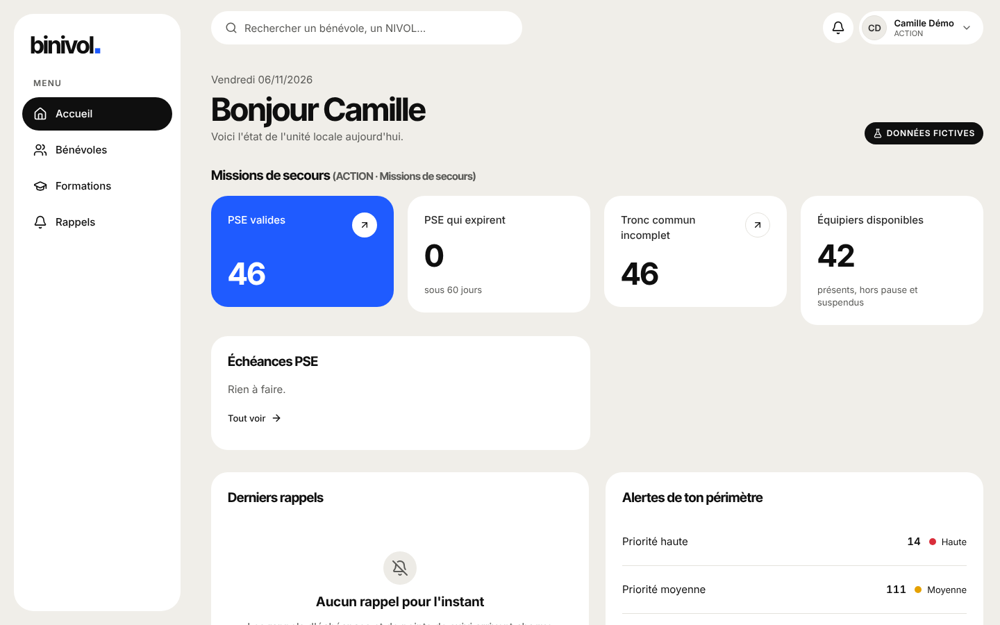

# Guide ACTION (missions de secours)

Tu suis les bénévoles PSC et PSE de ton périmètre.

## Se connecter

Ton identifiant et ton mot de passe, choisis en ouvrant le lien d'invitation envoyé par le DLUS. Mot de passe oublié : demande-lui un nouveau lien.

## Tâches courantes

- **Trouver une équipe** : Formations → Trouver : choisis jusqu'à 3 compétences (ex. PSE + PSC),
  puis « Copier les e-mails » pour écrire aux bénévoles.
- **Échéances** : l'accueil liste les PSE qui expirent sous 60 jours ; la matrice (Formations →
  Matrice) montre tout le monde d'un coup d'œil.
- **Nommer à une fonction** (chef de poste…) : fiche → Fonctions → « Nommer ». Un mineur ne
  peut pas être nommé à une fonction interdite aux mineurs.
- **Alertes** : Rappels → Alertes, pour les formations de ton périmètre.

## Qui contacter

FORMAT pour une formation à organiser ; TOPAZE pour une décision.
