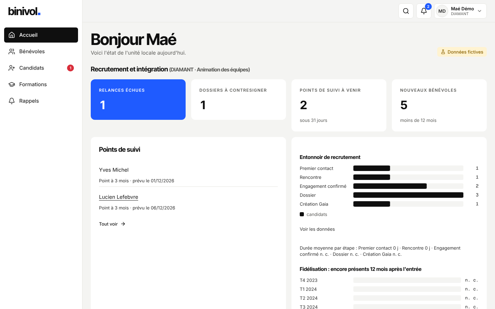

# Guide DIAMANT (animation des équipes)

Tu accueilles les candidats et suis les nouveaux bénévoles (moins de 12 mois) et les filleuls.

## Se connecter

Bouton « Se connecter avec Google », compte **@croix-rouge.fr**.

## Tâches courantes

1. **Nouveau candidat** : Candidats → « Nouveau candidat ». Il apparaît au « Premier contact ».
2. **Faire avancer** : sur la carte du candidat, change d'étape (rencontre, engagement
   confirmé…). Une relance est proposée ; en retard, elle apparaît en rouge.
3. **Envoyer le dossier** : fiche → Intégration → « Envoyer le lien du dossier ». Le candidat
   le remplit sur son téléphone et signe avec un code reçu par e-mail.
4. **Contresigner** : quand le dossier est signé, « Contresigner », puis la fiche Gaia à copier.
5. **Finaliser** : saisis le NIVOL donné par Gaia : la personne devient bénévole active, son
   point à 3 mois est planifié.
6. **Points de suivi** : Candidats → Suivi des bénévoles. « Compléter le point » : date, court
   compte rendu (jamais affiché dans une liste), prochain point (par défaut l'anniversaire
   d'entrée).
7. **Parrainage** : fiche → Intégration → parrain ; fin proposée après 12 mois.
8. **Retour d'un ancien** : fiche d'une personne partie → « Retour d'un ancien », avec le motif.

## Rappels

La cloche signale les candidatures sans action, les dossiers non signés, les points de suivi
et les reprises de pause.

## Qui contacter

TOPAZE (DLUS) pour une décision ; Léandre pour un problème technique.
