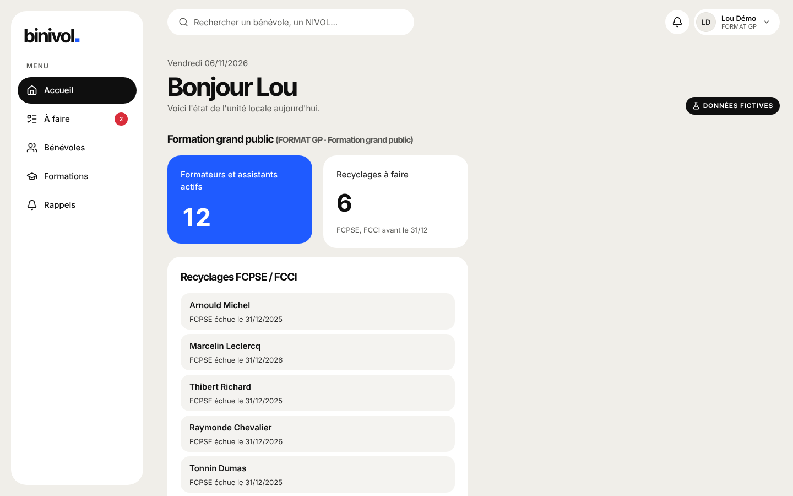

# Guide FORMAT GP (formation grand public)

Tu suis les formateurs et assistants de formation grand public.

## Se connecter

Ton identifiant et ton mot de passe, choisis en ouvrant le lien d'invitation envoyé par le DLUS. Mot de passe oublié : demande-lui un nouveau lien.

## Tâches courantes

- **Recyclages** : l'accueil liste les FCPSE et FCCI à faire avant le 31/12.
- **Nommer un assistant** : fiche → Fonctions → « Nommer » (fonctions de ton périmètre).
- **Trouver des formateurs** : Formations → Trouver (FPSE, FPSC).

## Qui contacter

FORMAT pour une session ; TOPAZE pour une décision.
