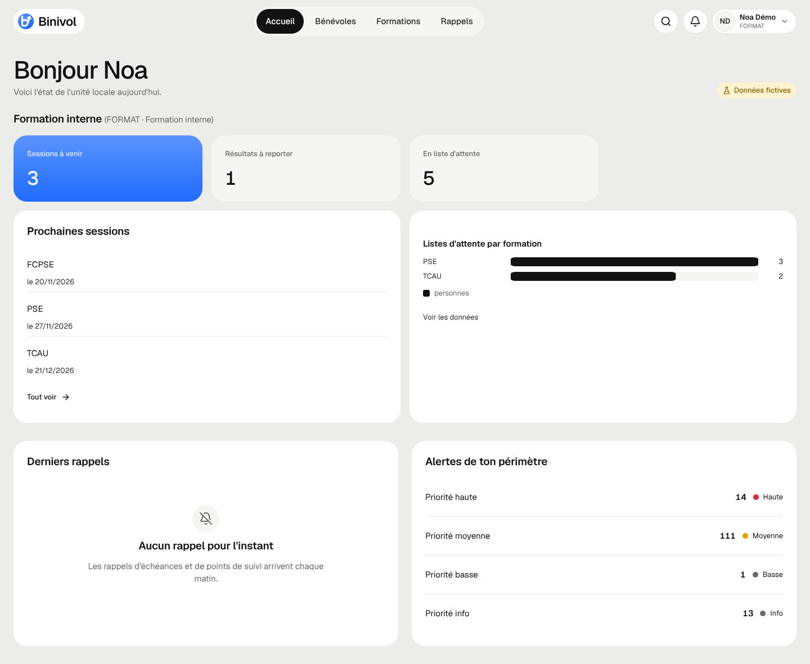

# Guide FORMAT (formation interne)

Tu organises les sessions et saisis les résultats pour tous les bénévoles.

## Se connecter

Bouton « Se connecter avec Google », compte **@croix-rouge.fr**.

## Tâches courantes

1. **Créer une session** : Formations → Sessions → « Nouvelle session ».
2. **Saisie de groupe** : Formations → Saisie de groupe : formation, date, coche les personnes,
   « Vérifier et enregistrer ». Les avertissements (prérequis, date future…) ne bloquent pas :
   « Enregistrer quand même » les garde dans l'historique.
3. **Résultats à reporter** : l'accueil les compte ; ouvre la session pour saisir le résultat.
4. **Listes d'attente** : Formations → Listes d'attente, par ordre de priorité.
5. **Référentiel** : Formations → Référentiel (codes, validité, prérequis).
6. **Matrice** : Formations → Matrice, « Exporter la vue (CSV) ».
7. **Récapitulatif TCAU** : bouton en haut de Formations, envoyé au pôle Urgence.

## Qui contacter

TOPAZE pour une décision ; Léandre pour un problème technique.
