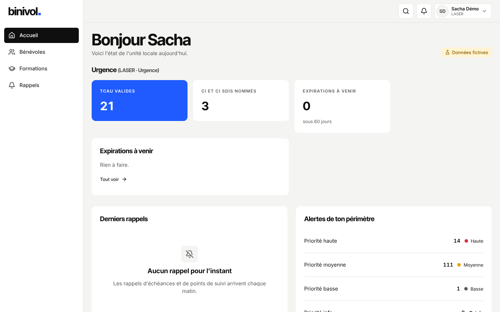

# Guide LASER (urgence)

Tu suis les bénévoles TCAU et PSE, et les chefs d'intervention.

## Se connecter

Bouton « Se connecter avec Google », compte **@croix-rouge.fr**.

## Tâches courantes

- **Qui est TCAU** : Formations → Trouver, compétence TCAU ; ou la matrice, catégorie « Tronc
  commun ».
- **Nominations** : CI, CI SDIS : fiche → Fonctions → « Nommer ».
- **Prévenance** : chaque session TCAU validée ou inscrite envoie un e-mail aux destinataires du
  pôle Urgence (réglés par TOPAZE).
- **Expirations** : l'accueil liste celles des formations de ton périmètre.

## Qui contacter

FORMAT pour une session ; TOPAZE pour une décision.
