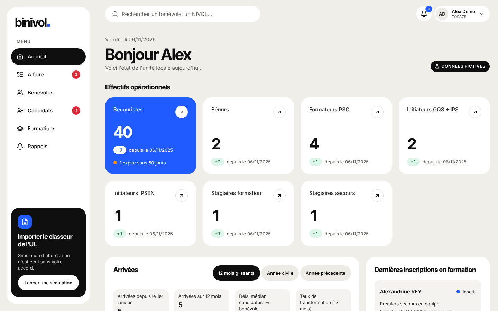

# Guide TOPAZE (DLUS)

Tu vois et gères tout. Ton accueil montre l'effectif, les alertes hautes, les B3 à vérifier et
les fiches à purger.

## Se connecter

1. Ouvre Binivol et clique « Se connecter avec Google ».
2. Utilise ton compte **@croix-rouge.fr**. Seuls les comptes créés par TOPAZE entrent.

## Ton accueil : le tableau de bord DLUS

- **Effectifs opérationnels** : secouristes, bénurs, formateurs PSC, initiateurs, stagiaires.
  Clique un chiffre : l'annuaire s'ouvre sur exactement ces personnes. Sous chaque chiffre, la
  variation sur 12 mois et ceux qui expirent sous 60 jours.
- **Dernières inscriptions** en formation, et **Arrivées** (par mois, délai médian, taux de
  transformation, entonnoir, fidélisation), avec un choix de période.
- Les définitions se règlent dans « Paramètres de l'UL » → « Tableau de bord DLUS »
  (« Aperçu » avant d'enregistrer).

## Tâches courantes

- **Créer un compte responsable** : menu du compte → « Gérer les comptes » → « Nouveau compte »,
  coche ses profils.
- **Traiter les alertes** : Rappels → Alertes, filtre « Haute », clique une alerte : la fiche
  s'ouvre au bon onglet. Une alerte disparaît dès que la donnée est corrigée.
- **Vérifier un B3** : Candidats → Suivi des bénévoles → « B3 à vérifier » → fiche, onglet
  Suivi → « Enregistrer la vérification du B3 » (date et issue, jamais de copie du casier).
- **Changer un statut** (pause, départ, retour) : fiche → « Changer le statut ». Au départ, les
  nominations et parrainages se terminent (cases cochées par défaut).
- **Purger** : menu du compte → « Purge RGPD » : coche les fiches, tape **PURGER**.
- **Exporter** : menu du compte → « Exports » (préfecture : à vérifier dans Pegass avant envoi) ;
  fiche → « Exporter les données (RGPD) » pour une demande d'accès.
- **Régler** : « Paramètres de l'UL » (délais, textes, Gaia) et « Réglages » (alertes, rappels,
  e-mails automatiques).
- **Contrôler** : « Journaux » (audit, consultations sensibles, consultations répétées en 24 h).

## Qui contacter

Le DPO de la Croix-Rouge française pour toute question sur les données personnelles ;
Léandre pour un problème technique.
