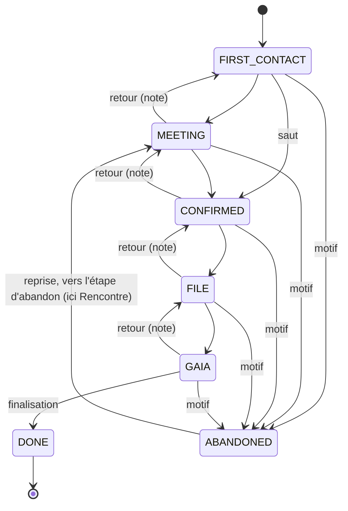

# Candidats et intégration

Guide du parcours d'intégration (profil **DIAMANT**, et TOPAZE) : de premier contact à bénévole
actif. Le code est dans `src/server/candidacy/` (règles pures), `src/server/services/candidacies.ts`
(écritures et lectures) et les écrans `/candidats` et l'onglet « Intégration » de la fiche.

## Le parcours en 6 étapes

| N°  | Étape               | Code            | Ce qui s'y passe                                                                                               |
| --- | ------------------- | --------------- | -------------------------------------------------------------------------------------------------------------- |
| 1   | Premier contact     | `FIRST_CONTACT` | un message, un appel, un salon, le site internet                                                               |
| 2   | Rencontre           | `MEETING`       | un entretien à l'unité locale (date et heure : `meetingAt`)                                                    |
| 3   | Engagement confirmé | `CONFIRMED`     | la personne veut s'engager                                                                                     |
| 4   | Dossier             | `FILE`          | dossier en ligne (`docs/dossier.md`) : créer le lien depuis « Confirmé » y fait passer ; signature à l'étape 8 |
| 5   | Création Gaia       | `GAIA`          | compte dans l'outil national, NIVOL et e-mail CRF (passage manuel ; assistant à l'étape 9)                     |
| 6   | Intégré             | `DONE`          | bénévole actif, par la **finalisation** uniquement                                                             |
| —   | Abandon             | `ABANDONED`     | depuis n'importe quelle étape ouverte, avec un motif                                                           |

Une seule candidature **ouverte** par personne (index partiel `candidacies_one_open`).

## La machine de passage

Règles pures dans `src/server/candidacy/machine.ts` (`decideTransition`, `availableTransitions`),
testées sur chaque couple d'étapes. Les services refusent tout passage qu'elle refuse, même
appelé sans l'interface ; l'interface lui demande quels boutons afficher.

| De \ vers           | Premier contact | Rencontre | Confirmé | Dossier  | Gaia     | Intégré      | Abandon |
| ------------------- | --------------- | --------- | -------- | -------- | -------- | ------------ | ------- |
| **Premier contact** | —               | avancer   | avancer  | non      | non      | non          | motif   |
| **Rencontre**       | note            | —         | avancer  | non      | non      | non          | motif   |
| **Confirmé**        | note            | note      | —        | avancer  | non      | non          | motif   |
| **Dossier**         | note            | note      | note     | —        | avancer  | non          | motif   |
| **Gaia**            | note            | note      | note     | note     | —        | finalisation | motif   |
| **Intégré**         | non             | non       | non      | non      | non      | —            | non     |
| **Abandon**         | reprise*        | reprise*  | reprise* | reprise* | reprise* | non          | —       |

- **avancer** : sans champ obligatoire ; la prochaine action et la relance sont proposées
  (`CANDIDACY_FOLLOW_UP_DAYS`, 7 jours par défaut).
- **note** : retour en arrière, note obligatoire.
- **motif** : abandon, motif obligatoire (Ne répond plus, N'est plus intéressé(e), Pas disponible,
  Orienté(e) ailleurs, Autre motif), note facultative.
- **reprise\*** : seulement vers l'étape où la candidature a été abandonnée ; on rouvre la même
  candidature, et un événement « Abandon → étape » le trace.
- **finalisation** : NIVOL obligatoire et date d'entrée (voir plus bas).

Le diagramme montre les retours d'une étape ; un retour de plusieurs étapes est aussi permis,
toujours avec une note.

Chaque passage écrit, **dans la même transaction**, la mise à jour de la candidature, son entrée
d'audit et un `CandidacyEvent` (qui, quand, de quelle étape vers laquelle, quelle note).

### Concurrence

Chaque passage envoie l'étape affichée à l'écran (`expectedStage`). La mise à jour ne s'applique
que si l'étape est toujours celle-là (`UPDATE … WHERE stage = expectedStage`) ; sinon le second
responsable reçoit « La candidature a changé entre-temps : rechargez la page. », et rien n'est
écrit (ADR-033).

## Relances

- **En retard** : la date de relance est passée (pastille danger). **Aujourd'hui** : pastille
  warn. Les retards sont comptés dans la carte « Relances en retard » de `/candidats` et dans la
  pastille du menu « Candidats ».
- **Sans action depuis N jours** : depuis le dernier événement de la candidature.
- Pas de notification ni d'e-mail à cette étape : c'est l'étape 12.

## Création et doublons

Un nouveau candidat demande le prénom, le nom, et un e-mail **ou** un téléphone. Le reste est
facultatif : source (suggestions tirées des sources existantes, regroupées sans casse ni
accents), intérêt, date du premier contact (aujourd'hui par défaut), note.

Avant d'enregistrer, Binivol cherche les personnes de **tous statuts** qui ont :

- le même e-mail ;
- ou le même téléphone normalisé ;
- ou le même nom et prénom, sans accents ni casse.

Pour chaque fiche trouvée (ADR-034) :

| Fiche trouvée                                | Proposition                                  |
| -------------------------------------------- | -------------------------------------------- |
| partie ou inactive, sans candidature ouverte | « C'est la même personne : réengager »       |
| candidate avec une candidature en cours      | « C'est la même personne : ouvrir sa fiche » |
| bénévole active, en pause ou suspendue       | « déjà bénévole » : aucune candidature       |
| non visible dans l'annuaire du compte        | « une fiche existe déjà… », sans aucun champ |

« Créer quand même » crée la fiche et écrit dans l'audit la liste des fiches écartées. La
recherche ne montre que les champs de l'annuaire.

## Réengagement

Une personne partie ou inactive reçoit une **nouvelle** candidature sur sa fiche existante, à
« Premier contact ». Son statut ne change pas avant la finalisation ; la candidature la fait
entrer dans le périmètre DIAMANT. L'onglet « Intégration » de sa fiche propose aussi
« Réengager cette personne ».

## Finalisation

Réservée à DIAMANT et TOPAZE (`candidacy.manage`), depuis « Création Gaia » :

- **NIVOL** obligatoire, normalisé (espaces retirés, majuscules), valide, sans doublon ; en cas
  de doublon, le message nomme la fiche si l'acteur peut la voir ;
- **e-mail CRF** facultatif, en `@croix-rouge.fr` ;
- **date d'entrée**, aujourd'hui par défaut.

En **une seule transaction** : la personne passe en Actif (départ effacé pour une personne
réengagée), la candidature est close en « Intégré », un point de suivi « Point à 3 mois » est
planifié à la date d'entrée + 3 mois, l'audit et l'événement sont écrits. Un échec au milieu
n'écrit rien. L'écran propose ensuite d'attribuer un parrain.

## Parrainage

`mentorship.manage` sur le filleul (personne du périmètre DIAMANT). Le parrain est un bénévole
**actif**, **majeur** (date de naissance connue), différent du filleul, sans parrainage en cours
avec lui. Les parrains proposés sont classés par nombre de filleuls actuels (croissant), puis par
ancienneté. Un parrainage se termine avec une date de fin et une note ; un autre peut ensuite
commencer. Le suivi détaillé vient à l'étape 11.

## Droits

| Écran                          | Qui                                  | Sinon                         |
| ------------------------------ | ------------------------------------ | ----------------------------- |
| `/candidats`                   | `candidacy.manage` (TOPAZE, DIAMANT) | 403                           |
| Nouveau candidat, réengagement | `candidacy.create` (TOPAZE, DIAMANT) | bouton absent, action refusée |
| Onglet « Intégration »         | `candidacy.manage` sur la personne   | onglet absent                 |
| Fiche d'un candidat            | profils qui voient les candidats     | 404 (ACTION, LASER, FORMAT…)  |

`/candidats` filtre en SQL par `visibleSql(actor, "candidacy.manage")` : un profil qui ne gère
pas une candidature ne la reçoit jamais, ni dans les cartes ni dans les chiffres.
